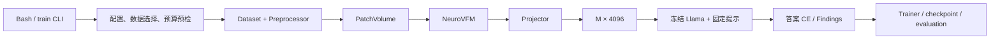
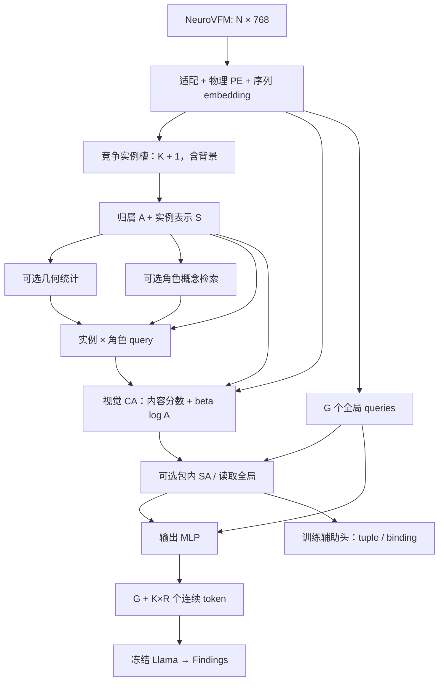

# BindFormer：单序列脑 MRI 的实例—属性绑定压缩方案与实现计划

日期：2026-10-13。代码核对基点：Git HEAD `464b946`。

状态：**设计整理与代码接入计划，尚未实现 BindFormer、生成事实标签或启动训练。** 本文保留原方案的核心结构，修正公式排版，并区分已有能力、待验证假设和工程建议。目录名沿用 `Pipeline_0929`。

2026-10-14 更新：第 19 节补充当前输入/标注缺口、tuple/binding 监督解释、本地 BioLORD 编码检查、UMLS 候选消歧结果和离线资产实施顺序。

2026-10-15 更新：第 20 节根据跨数据集迁移和标注成本的约束，提出以图像—报告配对为默认输入的训练候选；原 tuple/binding 作为可选监督分支，尚未进行效果验证或代码实现。

## 1. 这个 pipeline 在解决什么问题

当前任务是：输入**一个完整的单序列 3D 脑 MRI**，由 NeuroVFM 提取 patch 特征，经 projector 转成 Llama-3.1-8B 可读的连续视觉 token，生成该序列的英文 Findings。

BindFormer 要验证的假设是：**在相同输出 token 预算下，先把视觉证据组织成组，再在组内读取不同属性，并监督属性的共同归属，能够减少压缩后的事实遗漏和属性错配。**

例如，图像包含“左额叶的点状异常”和“右顶叶的片状异常”。仅保留“左、右、额叶、顶叶、点状、片状”这个概念集合，还不能保证报告把它们组合正确。本方案试图保留的是“哪个证据组具有哪些属性”。

这里的实例槽是**学习得到的证据组**，不是已经验证的病灶实例或分割。一个槽可以对应局灶异常、区域性异常或弥漫改变；同一异常也可能被多个槽拆分。全局分支承担整体结构、正常所见和未被局部槽覆盖的上下文。

| 任务特点 | 对设计的要求 |
| --- | --- |
| 3D 特征多，小异常可能占很少 patch | 压缩前读取完整特征，单独检查小异常遗漏 |
| 同类异常可能重复出现 | 类别/CUI 不能代替患者内实例身份 |
| 位置、侧别、范围决定事实含义 | 使用方向正确的物理几何，不能只按外观聚合 |
| 信号解释依赖 MRI 序列 | 显式提供序列身份，保持单序列可见性边界 |
| 报告标注不完整 | 区分缺失、明确否定、不确定；未提及不作负标签 |
| encoder 与 LLM 冻结 | 在 projector 处干预，保留 LLM 对视觉输入的反向梯度 |

这些问题不是医学领域独有。研究重点是它们在脑 MRI、强压缩、弱实例监督和冻结模型条件下的组合。前提是需要的信息已存在于 NeuroVFM 特征中；projector 无法恢复 encoder 已经丢失的证据。

## 2. 当前仓库与正在进行的实验

### 2.1 数据与模型状态

活动监督版本为 `single_sequence_findings_coref_v2`；默认 `data.datasets: [brats]`。直接统计本地清单得到：

| split | 全部来源序列数 | 默认 BraTS 序列数 | 默认 BraTS 独立患者数 |
| --- | ---: | ---: | ---: |
| train | 2177 | 1960 | 484 |
| val | 299 | 268 | 67 |
| test | 622 | 560 | 140 |

全部来源包含 BraTS GLI/MEN/MET、ISLES22、WMH；序列数不是患者数。本次统计未借助 val/test 报告设计概念词表。

- 默认预处理：RPI 方向、`native_grid`、`minimal_pad`，完整视野，不删除背景 patch。
- NeuroVFM patch 为网络 DHW 顺序的 `[4,16,16]`，每 patch 展平为 1024 个数；本地 encoder 输出维度为 768。
- 当前 BraTS ratio 预算对应的标准网格为 `[39,15,15]`，输入 `N=8775`。
- 本地 Llama hidden size 为 4096；实现仍应读取 `decoder.hidden_size`，不能硬编码。
- `Sample` 保存 `finding`、`sequence`、患者/检查身份和审核标记；**没有实例 tuple、字段 mask、CUI 标签或概念库**。
- mask 路径存在于清单中，但训练 dataset 不读病灶 mask；mask 用于独立 QA。
- coreference v2 做过文本指代修订，不等于影像可见性或 tuple 归属已获临床核验，见 [指代修订记录](MODAL_FINDINGS_COREFERENCE_REVISION.md)。

### 2.2 文件结构与职责

| 目录/入口 | 当前职责 | 与 BindFormer 的关系 |
| --- | --- | --- |
| `configs/`、[src/config.py](../src/config.py) | 严格 YAML、参数校验、路径与配置身份 | 参数必须进入 schema/defaults |
| [src/data/manifest.py](../src/data/manifest.py)、`dataset.py`、`collate.py` | 患者隔离、目标版本校验、完整体积列表 batch | 新增独立事实标签 sidecar |
| [src/preprocessing/](../src/preprocessing/) | 方向、重采样、padding、patch、几何与缓存 | 已有 affine，可推导物理 patch 几何 |
| [src/models/encoders/neurovfm.py](../src/models/encoders/neurovfm.py) | 每体积特征/坐标/metadata；冻结/LoRA/full；特征缓存 | 主实验复用冻结特征 |
| [src/models/projectors/](../src/models/projectors/) | 11 种 projector、注册、预算与输出契约 | 新增 `bindformer3d` 及独立子模块 |
| [src/models/multimodal.py](../src/models/multimodal.py) | encoder → projector → decoder；报告 CE | 传序列身份，连接辅助输出/监督 |
| [src/models/decoders/llama.py](../src/models/decoders/llama.py) | 替换 `<image>`、答案 CE、冻结 LLM、生成 | 连续 token 接口可直接复用 |
| [src/tasks/single_sequence_findings.py](../src/tasks/single_sequence_findings.py) | 固定提示、序列名、英文 Findings 目标 | 保持相同 prompt，不输入辅助事实文本 |
| [src/training/](../src/training/) | optimizer、累积/DDP、调度、checkpoint、早停 | 增加独立归一化辅助 loss |
| [src/evaluation/](../src/evaluation/) | 文本/临床评分、患者 bootstrap、视觉对照 | 增加绑定与严格图像置换检查 |
| `scripts/baselines/`、[baseline_sweep.py](../src/cli/baseline_sweep.py) | 按比例独立训练，随后评测 best checkpoint | 当前固定 joint_lora，不直接作为冻结两端入口 |
| `tests/` | 几何、预算、梯度、loss、恢复与评测契约 | 扩展新增行为的测试 |
| `assets/`、`cache/`、`runs/`、`third_party/` | 数据/模型、缓存、实验产物、本地依赖 | 概念库与事实标签独立版本化 |

现有 projector：`mlp2x_gelu`、`avgpool3d`、`concat3d`、`convpool3d`、`mixer3d`、`local_packer3d`、`attention_pool`、`perceiver_nv`、`perceiver_flamingo`、`adaptive_merge3d`、`token_select3d`。

### 2.3 当前真实调用链



接口按单体积调用，变长 batch 用列表组织：

```python
Projector.forward(features, coords, metadata) -> ProjectedVolume
# features: [N, input_dim]
# coords: [N, 3]，完整规则网格的整数 DHW 索引
# ProjectedVolume: embeddings, input_tokens, output_tokens, metadata
```

`ProjectedVolume.validate()` 已检查形状、有限值和 `training.required_visual_tokens`。`StructuredProjector` 提供输入/预算检查及输出 metadata，适合作为父类。

### 2.4 代码与原设想的差距

| 问题 | 已有实现 | 本方案所需 |
| --- | --- | --- |
| 坐标 | 整数网格；encoder 自身有位置编码；metadata 保存 LPS affine | 物理中心、有效体积、方向保持的 PE |
| 序列 | `Sample.sequence` 用于 prompt，未传 projector | 仅传允许的序列 ID，不传整份 Sample/报告 |
| Query | CA+FFN；Flamingo 变体将 latent 加入 K/V | 竞争槽、角色 query、支持域 bias |
| 几何 | `physical_extent()` 提供 padded 视野尺度 | 不能代替逐 patch 物理坐标/有效体积 |
| 辅助输出 | embeddings 和可序列化 metadata | 独立的可反传辅助张量通道 |
| 训练目标 | 只有 `loss_sum`、`answer_tokens` | tuple/binding/concept 分别归一化 |
| 知识与标签 | 尚无相关模块 | 概念库、schema、部分标签、审核与版本 |
| 训练设置 | baseline 默认 joint_lora，后续解冻视觉 LoRA | 主实验 stage=a，LoRA 独立对照 |
| 评测 | BLEU、ROUGE、GREEN、RadGraph-XL、RaTEScore、BERTScore、CE | 实例绑定、小异常与图像依赖性评价 |

根 README 部分段落仍写“BERTScore 尚未实现”，但当前 `evaluate_checkpoint.py`、`clinical_scorers.py` 及测试已有实现；本文以代码和 [评价文档](EVALUATION_METRICS_AND_NEUROQA_PLAN.md) 为准。本轮未改旧 README。

## 3. 总体接口与结构

$$
X=E_{\mathrm{vis}}(V)\in\mathbb R^{N\times768},\qquad
Z=P_\theta(X,p,m,\mathcal C)\in\mathbb R^{M\times4096},\qquad
\hat y=D_\phi(Z,u).
\tag{1}
$$

| 符号 | 含义 |
| --- | --- |
| \(V,X,N\) | 单序列体积、全部视觉特征、输入 patch 数 |
| \(p_i,m\) | patch 物理中心、序列类型 |
| \(d,d_t\) | projector 内部宽度、文本向量宽度 |
| \(G,K,R\) | 全局 token 数、证据槽容量、每槽角色数 |
| \(\mathcal C,\mathcal C_r,E\) | 固定概念库、角色候选集合、缓存概念向量 |
| \(a_{ik},b_{kr}\) | patch 到槽软归属、槽 k 的角色 r 视觉 token |
| \(u,y,\hat y\) | 固定任务提示、参考 Findings、生成 Findings |

主实验冻结 encoder 与 LLM，仅训练 projector 和辅助头。LLM 参数 `requires_grad=False`，但训练前向不能包在 `no_grad()` 内；当前 decoder 已满足此要求。

$$
h_i=W_x\operatorname{LN}(x_i)+\operatorname{PE}(p_i)+E_{\mathrm{seq}}(m),
\qquad H=[h_i]_{i=1}^N\in\mathbb R^{N\times d},
\tag{2}
$$

$$
M=G+KR.
\tag{3}
$$

初始角色为 finding、location/laterality、signal、morphology/extent。一个角色可对应多个监督字段；R 不等于字段数。背景槽只参与内部路由，不额外输出 token。K 是容量，不是病灶数。



## 4. 实例分组：先建立共同证据来源

初始化可区分的 K 个可学习槽及背景槽 \(s_0\)，不预设疾病或位置。迭代 t：

$$
\ell_{ik}^{(t)}=\frac{(W_s s_k^{(t)})^\top(W_hh_i)}{\sqrt d},
\qquad
a_{ik}^{(t)}=\operatorname{softmax}_{k=0,\ldots,K}(\ell_{ik}^{(t)}).
\tag{4}
$$

每个 patch 在槽之间竞争，\(\sum_k a_{ik}=1\)。随后沿 patch 轴归一化并汇聚：

$$
n_k^{(t)}=\sum_i a_{ik}^{(t)},\quad
\bar a_{ik}^{(t)}=\frac{a_{ik}^{(t)}}{\epsilon+n_k^{(t)}},\quad
\bar h_k^{(t)}=\sum_i\bar a_{ik}^{(t)}h_i,
\tag{5}
$$

$$
s_k^{(t+1)}=F_{\mathrm{slot}}(s_k^{(t)},\bar h_k^{(t)}).
\tag{6}
$$

更新用 GRU + 残差 MLP。最后一次更新后重新计算 A，确保支持域与最终 S 对齐。建议起始迭代 3 次，作为待验证配置。

A 存 `[N,K+1]`，明确两次归一化的轴。完全无有效覆盖的 patch 不参与汇聚/读取；有效视野由几何定义，不由病灶 mask 或强度阈值定义。部分 padding patch 是否按有效比例加权槽汇聚，是额外变体，不能无记录地改变式（5）。

分组在槽之间 softmax，属性读取在 patch 之间 softmax。竞争不保证覆盖所有异常；背景槽不等价于正常组织。

## 5. 物理几何与支持范围

对非背景槽计算：

$$
\mu_k=\frac{\sum_i a_{ik}p_i}{\epsilon+\sum_i a_{ik}},\qquad
\Sigma_k=\frac{\sum_i a_{ik}(p_i-\mu_k)(p_i-\mu_k)^\top}
{\epsilon+\sum_i a_{ik}},\qquad
\nu_k=\sum_i a_{ik}\Delta V_i.
\tag{7}
$$

求和限定在有效 patch；部分 padding 的 \(\Delta V_i\) 只计真实覆盖体积。中心可采用有效覆盖部分的中心，需与完整 patch 中心的选择一起记录。若改用体积加权 \(\mu,\Sigma\)，作为单独变体。

使用中心 3 维、对称协方差 6 个独立分量、`log1p(soft_volume)` 等标准化量，通过小 MLP 得到 \(g_{kr}\in\mathbb R^d\)。初版仅位置和形态/范围角色使用，其余角色取 0。

### 从现有 metadata 恢复物理坐标

`coords` 必须继续作为 encoder/网格的整数 DHW 输入，另外构造 `PhysicalPatchGeometry`：

1. 根据 patch size 与 index 得到 padded 数组内 voxel 中心：`index * patch_size + (patch_size - 1) / 2`。
2. 逆变换 `array_zyx_to_dhw` 恢复 ZYX，再转 XYZ，不能假设 D 总是物理 Z。
3. 减去 `pad_before_xyz`，得到 `bounded_before_pad` 图像内 index。
4. 使用 `bounded_before_pad.affine_xyz_to_lps` 转成 LPS mm；裁剪偏移已在 affine 中，不能重复加 `crop_start_xyz`。
5. patch 覆盖范围与未 padding 图像范围求交，计算有效 voxel 数和体积；单 voxel 体积用 affine 线性部分行列式绝对值。
6. PE 使用方向保持的标准化坐标，同时保存未标准化 mm 统计；数据统计归一化只在 train 拟合。

LPS 方向确定不等于配准到脑图谱；LPS x=0 或视野中心不自动等于解剖中线。建议方向保持的视野中心化坐标配合尺度摘要，避免把任意扫描 origin 当作解剖标签。左右侧需用 header、合成翻转和真实图像核对。

第一轮可从已有缓存 metadata 纯函数推导几何，不必仅为新增派生坐标重算 encoder 特征。若修改预处理数值/缓存内容，更新版本身份。

这些量是软支持域摘要，不能直接作为真实病灶体积、直径或分割输出。

## 6. UMLS 概念记忆与角色 query

本版本使用名称、同义词、定义、语义类型，不做图网络推理。UMLS 提供概念资源，不提供当前患者实例或坐标。[NLM UMLS](https://www.nlm.nih.gov/research/umls/index.html)、[Metathesaurus 手册](https://www.ncbi.nlm.nih.gov/books/NBK9684/)。

“UMLS 解释的一段话作为 class token”具体化为：**每个概念有固定文本向量；图像槽按角色软检索这些向量，用于构造读取 query。** 不是每个疾病固定占一个输出 token，也不是把定义追加给 LLM。

### 6.1 离线构建

从训练报告术语与预先确定的公开医学词表建立候选，链接并审核 CUI；无准确 CUI 的修饰词保留本地 ID。四种角色由项目 schema 定义，不是 UMLS 自带分组。

| 角色 | 示例候选范围 |
| --- | --- |
| finding | 可观察异常、占位性改变；避免以诊断代替视觉事实 |
| location/laterality | 解剖部位，侧别单列子字段 |
| signal | 带序列语境的高/低/等信号及混合描述 |
| morphology/extent | 点状、片状、边界、局灶/弥漫等 |

保存 concept ID/CUI、标准名、同义词、定义来源/版本、角色、审核状态、文本模板、词表/向量哈希和文本模型版本，保留 unknown/other。缺失标签和明确标注 unknown 不是同一状态。

$$
e_c=\operatorname{Normalize}
\left(E_{\mathrm{text}}(\mathrm{name}_c,\mathrm{description}_c)\right)
\in\mathbb R^{d_t}.
\tag{8}
$$

文本 encoder 冻结、离线运行。SapBERT 可作为候选，但其主要验证任务是实体表示/链接，不自动保证长定义适合视觉 query；需要固定 pooling、模板、最大长度，并比较 name-only 与 name+definition。[SapBERT 原论文](https://aclanthology.org/2021.naacl-main.334/)。

### 6.2 在线查询

$$
u_{krc}=\frac{(W_c s_k)^\top(T_r e_c)}{\sqrt d},\qquad
\eta_{krc}=\operatorname{softmax}_{c\in\mathcal C_r}(u_{krc}),\qquad
e_{kr}=\sum_{c\in\mathcal C_r}\eta_{krc}e_c,
\tag{9}
$$

$$
q_{kr}=W_qs_k+U_re_{kr}+v_r+g_{kr}.
\tag{10}
$$

\(W_c,W_q\in\mathbb R^{d\times d}\)，\(T_r,U_r\in\mathbb R^{d\times d_t}\)，\(v_r\) 是角色 embedding。知识检索的 value 来自概念库，视觉读取的 value 来自图像，二者不能混淆。

\(\eta\) 是语义混合，不是诊断概率；一个槽可涉及多个 CUI，一个 CUI 可对应多个患者内实例。视觉与文本空间需要学习映射，不天然对齐。

训练与推理使用同一固定候选库，不读取当前参考报告筛候选；val/test 新术语按冻结 schema 处理。知识会改变读取偏好，“只进 query”不能保证无幻觉。

## 7. 属性读取：共享支持域，角色分别取证

$$
t_{kri}=\frac{(W_Qq_{kr})^\top(W_Kh_i)}{\sqrt d},\qquad
\alpha_{kri}=\operatorname{softmax}_i
\left[t_{kri}+\beta_r\log(\epsilon+a_{ik})\right],
\tag{11}
$$

$$
b_{kr}=\sum_i\alpha_{kri}W_Vh_i\in\mathbb R^d.
\tag{12}
$$

等价地，

$$
\alpha_{kri}=
\frac{\exp(t_{kri})(\epsilon+a_{ik})^{\beta_r}}
{\sum_{j=1}^{N}\exp(t_{krj})(\epsilon+a_{jk})^{\beta_r}}.
\tag{13}
$$

内容分数决定细节，A 使同槽各角色具有共同来源，不要求 attention 完全相同。beta=0 完全移除支持域 bias；query 仍依赖槽，因此不是移除整个实例结构。

建议先比较固定 beta=0/1，再研究 `softplus(raw_beta)`。`support_mode=none` 要显式生成零 bias，不能靠 softplus 近似零。过强约束会放大错误路由，病灶核心、水肿与占位效应也不必严格共定位。

**不能直接复用现有 QueryBlock 作为首次属性读取。** [common.py](../src/models/projectors/common.py) 使用 `queries + attended + FFN`。当 query 含知识向量，残差会让知识直接进入输出，偏离式（12）的视觉 value 路径。新增 `SupportBiasedReader`，首次输出以视觉 attended value 为基础，可接 LN/FFN；后续残差只能来自已经读取的证据 token。全局分支可继续用普通 QueryBlock。

多头版本按 \(\sqrt{d_h}\) 缩放，支持 bias 广播到各头，valid mask 同时生效。log/softmax/几何矩尽量 FP32；A 保持可导，detach 只能作为明确消融。NeuroVFM 已有上下文混合，attention 不能直接解释成分割或因果证据。

## 8. 全局补充、交互与输出

$$
B_{\mathrm g}=F_{\mathrm{global}}(Q_{\mathrm g},H)
\in\mathbb R^{G\times d}.
\tag{14}
$$

每槽角色构成 \(B_k\in\mathbb R^{R\times d}\)，可选：

$$
B'_k=B_k+\operatorname{SA}(\operatorname{LN}(B_k)),\qquad
\widetilde B_k=B'_k+
\zeta_k\operatorname{CA}(\operatorname{LN}(B'_k),B_{\mathrm g}),
\quad \zeta_k\in[0,1].
\tag{15}
$$

包内 SA 只作用于同槽 R 个 token；局部读全局的 Q 来自本槽，K/V 来自全局 token。初版均关闭，不默认增加跨槽广泛 SA。

$$
Z=\operatorname{Concat}_{\mathrm{token}}
\left[F_{\mathrm{out}}(B_{\mathrm g}),
F_{\mathrm{out}}(\widetilde B_1),\ldots,
F_{\mathrm{out}}(\widetilde B_K)\right]
\in\mathbb R^{M\times4096}.
\tag{16}
$$

顺序固定为 global → slot-major → role-major，不按报告重排。保留所有槽的 token，不按预测病灶数改变 M；不增加预算外概念 token、事实文本或头预测 argmax。

辅助头接在交互之后的 \(\widetilde B\)，即输出 MLP 之前。它不自动证明信息保留在 Z 中或被 LLM 使用；需配合 Z 的离线 probe 和生成 tuple 评价。

## 9. 完整事实组与绑定监督

### 9.1 共同 Hungarian 匹配

离线解析部分标注集合 \(\mathcal T=\{t_\ell\}_{\ell=1}^L\)，可靠字段 mask 为 \(\omega_{\ell j}\in\{0,1\}\)。字段经 \(r(j)\) 映射到角色，预测为 \(p_{kj}=\mathcal H_j(\widetilde b_{k,r(j)})\)：

$$
C_{k\ell}=\sum_j\omega_{\ell j}\,\ell_j(p_{kj},t_{\ell j}),\qquad
\pi^*=\arg\min_{\pi\ \mathrm{injective}}
\sum_{\ell=1}^L C_{\pi(\ell),\ell}.
\tag{17}
$$

$$
\Omega=\max(1,\sum_{\ell,j}\omega_{\ell j}),\qquad
\mathcal L_{\mathrm{tuple}}=
\frac1\Omega\sum_{\ell=1}^L C_{\pi^*(\ell),\ell}.
\tag{18}
$$

同一事实组的所有字段共用一次匹配。可在 detached CPU cost 上求离散索引，再从原始可导 cost/logits gather；不能逐字段分别匹配。

单分类用 CE，多标签用 BCE。多标签还需标签维度 observed mask：已知某项阳性不意味着其余项阴性。先对每字段已观测标签归一化，再汇总成本；评分 S 使用相同约定。

未匹配槽不直接作“无病灶”负标签。无可靠字段的 tuple 离线排除；L=0 时返回安全反传的零；L>K 必须预检报错并调整容量/组级协议，不能截断事实。

全局正常结构、全局否定通常不适合局部实例支持，首版由 RG/global 分支处理；局部事实允许明确否定和不确定。不能把所有否定句都强制建成病灶槽。

### 9.2 绑定负例

交换两个归属明确的事实组的部分属性，保持概念集合不变：

$$
S(B,\mathcal T)=
\max_{\pi\ \mathrm{injective}}
\frac1\Omega\sum_{\ell,j}
\omega_{\ell j}\log p_{\pi(\ell),j}(t_{\ell j}),
\tag{19}
$$

$$
\mathcal L_{\mathrm{bind}}=
\max\{0,\gamma-S(B,\mathcal T)+S(B,\widetilde{\mathcal T})\}.
\tag{20}
$$

多标签用 masked Bernoulli log-likelihood。正例与负例分别求最佳共同匹配，不能直接把正例索引当作负例最佳索引。

只交换 tuple 顺序不是负例；属性相同、归属不清、交换后仍可能正确时跳过。首版每个 eligible 样本按固定规则取一个交换负例，保存规则版本/随机种子和跳过原因；无负例时 loss=0。

不必额外增加联合 MLP，但此目标不保证排除退化解：K 很大时不同槽可能同时表示正误组合；缺少区分字段时两个集合可能不可辨。需记录负例覆盖率、正负分数差、重复槽及生成绑定错误，不能只看训练 loss。

### 9.3 总目标

$$
\mathcal L_{\mathrm{RG}}=
-\frac1{T_y}\sum_{\tau=1}^{T_y}
\log p_\phi(y_\tau\mid y_{<\tau},u,Z),\qquad
\mathcal L=\mathcal L_{\mathrm{RG}}
+\lambda_t\mathcal L_{\mathrm{tuple}}
+\lambda_b\mathcal L_{\mathrm{bind}}.
\tag{21}
$$

代码的 RG 包含答案结束符，按累积窗口的全局答案 token 数归一化。可选概念监督只用于单一、可靠概念标签：

$$
\mathcal L_{\mathrm{concept}}=
-\frac1{\max(1,\sum_{\ell,r}\chi_{\ell r})}
\sum_{\ell,r}\chi_{\ell r}
\log\eta_{\pi^*(\ell),r,c_{\ell r}}.
\tag{22}
$$

以 \(\lambda_c\) 加入总损失，主版本先关闭；多标签角色不能直接套用。

### 9.4 Trainer 的归一化契约

当前 Trainer 用 `loss_sum * world_size / global_answer_tokens`。**不能把辅助损失加进同一个 loss_sum 后一起除以文本长度。**

保留 `loss_sum` 为纯 RG 分子，另返回每样本按式（18）等归一化后的辅助 loss 之和。W 为 world size，T/B 为整个累积窗口的全局答案 token 数/实际样本数；每个 microbatch 反传：

$$
\frac WT\,\mathrm{RGSum}
+\frac WB\left(
\lambda_t\mathrm{TupleSampleSum}
+\lambda_b\mathrm{BindSampleSum}
+\lambda_c\mathrm{ConceptSampleSum}\right).
$$

无标签/负例样本的对应项为零；这一约定保持单样本目标且不随 microbatch 划分变化。如果改为仅 eligible 样本平均，要作为不同配置，因为有效 loss 权重会改变。

T/B 在 window 开始前计数并 all-reduce。日志分别记录 RG、辅助项、字段数、eligible 数。主协议仍以相同完整 val answer CE 选择 best checkpoint，绑定指标独立记录。

## 10. 模块化代码结构与接入点

以下路径为**计划新增**：

```text
src/models/projectors/bindformer/
  __init__.py
  projector.py          # BindFormer3D，流水线与输出
  types.py              # 内部张量类型/辅助输出
  input_adapter.py      # LN、投影、PE、序列 embedding
  physical_geometry.py  # metadata → 物理中心/有效体积
  slots.py              # CompetitiveSlotRouter
  geometry_encoder.py   # 支持域矩 → 几何向量
  concept_memory.py     # E buffer、角色候选、软检索
  role_queries.py       # 实例 + 角色 + 可选语义/几何
  reader.py             # 支持域 bias CA，视觉 value 输出
  interactions.py       # 包内 SA、局部读全局及 gate
src/models/projectors/fact_heads.py   # 其他 query baseline 可复用
src/data/facts.py                    # sidecar 读取/schema 校验
src/training/fact_losses.py          # 匹配、tuple/binding/concept
src/evaluation/binding.py            # tuple 与绑定诊断
scripts/build_fact_annotations.py    # 离线抽取候选/审核导出
scripts/build_concept_bank.py        # UMLS 子集 → 固定概念向量
configs/projector/bindformer3d.yaml
configs/experiments/bindformer_*.yaml
scripts/baselines/run_bindformer3d.sh
```

| 模块 | 输入 → 输出 | 开关 |
| --- | --- | --- |
| 输入适配 | X、几何、sequence → H [N,d] | position、sequence condition |
| 实例路由 | H → S [K,d]、A [N,K+1] | iterations、background slot |
| 几何编码 | A、p、体积 → [K,R,d] | geometry enabled、role mask |
| 概念记忆 | S、E → eta、[K,R,d_t] | none/name/name_definition/control |
| 角色查询 | S、语义、角色、几何 → [K,R,d] | role schema |
| 属性读取 | Q、H、A → [K,R,d] | support none/shared、beta |
| 全局分支 | H → [G,d] | G、depth |
| 交互 | B、Bg → Btilde | within_slot_sa、local_reads_global |
| 输出头 | [M,d] → [M,decoder.hidden_size] | 复用 mapping_head |
| 辅助头/损失 | Btilde、字段 → logits/loss | lambda_t/b/c |

### 10.1 公共文件修改表

| 文件 | 计划改动 |
| --- | --- |
| `projectors/registry.py`、`specs.py` | 注册 bindformer3d、默认值、严格校验及互斥组合 |
| `projectors/base.py` | ProjectedVolume 增加默认 None 的 `auxiliary` 字段，兼容旧四参数构造 |
| `projectors/common.py` | finish 可传辅助输出，metadata 仍只存可序列化摘要 |
| `multimodal.py` | projector context 加 sequence，forward 组装各 loss，保留生成路径 |
| `config.py`、`configs/base.yaml` | 资产路径、loss 权重、特性校验；旧配置默认关闭新增功能 |
| `data/dataset.py` | 按 sample ID 读取 sidecar，item 新增 facts，不改变旧 Sample 必填字段 |
| `training/trainer.py`、`loss.py` | 各 loss 归一化、日志与 val 辅助诊断 |
| `training/checkpoint.py` | 纳入标签/schema/概念向量/抽取器内容哈希及 resume 校验 |
| `training/stages.py` | 辅助头无标签时的 DDP 参数使用处理 |
| `projectors/budget.py` | 后续增加 G/K/R 分解的 ratio 契约 |
| 实验 runner | 显式支持冻结 Stage A、固定 M，不套用当前强制 joint_lora sweep |
| `evaluation/visual_controls.py` | 新增同 cohort+sequence、跨患者 donor 的置换版本 |

**辅助张量不能塞 metadata。** A、eta、Btilde/logits 经 auxiliary 保持计算图；metadata 只存预算、标量摘要和资产 hash。完整 attention 图按需导出 detached CPU 文件，默认不随每步 JSON 序列化。

辅助头注册在 `model.projector` 子模块下，使现有 optimizer projector 参数组与 checkpoint state_dict 覆盖它们；无参数的 loss 放 training 模块。所有 layer/slot/head 在构造时创建，不能在 forward 动态新增参数。

Stage A DDP 当前默认不启用 find_unused_parameters。启用头但 batch 没有标签时，需从该头输出构造图连通零损失，或为新分支显式启用并验证 unused 检测；关闭模块时不实例化无用参数。现有“所有 projector 参数均有梯度”的测试需要按模块启用条件扩展。

概念 E 为冻结 buffer；精简 E 可随 checkpoint 保存，同时保存 ID 顺序/来源 manifest。加载不能只比路径，同路径资产内容变化也要拒绝 resume。正式推理不需要 UMLS API 或文本 encoder。

序列传递建议为 project_volumes 增加可选 sequences/context 参数，由 forward/generate 从 Sample.sequence 提取；逐体积构造新的 metadata/context 副本，避免原地修改共享缓存。旧 projector 忽略新增信息，启用 sequence_condition 的 BindFormer 则对缺失/未知序列明确报错。不得把 finding、mask 路径或 tuple 通过该通道传给 projector。

### 10.2 建议配置草案

以下示例**不是当前已经支持的配置**，需要实现 schema 后才能运行。首版纯结构、纯 RG，后续 preset 覆盖单个模块与 loss 权重。

```yaml
projector:
  name: bindformer3d
  hidden_size: 4096
  target_compression_ratio: null
  params:
    num_tokens: 256
    global_tokens: 32
    num_slots: 56
    roles: [finding, location_laterality, signal, morphology_extent]
    inner_dim: 768
    num_heads: 8
    slot_iterations: 3
    background_slot: true
    position_mode: physical_fourier
    sequence_condition: true
    geometry_enabled: false
    support_mode: shared
    support_beta: [1.0, 1.0, 1.0, 1.0]
    knowledge_mode: none
    concept_bank: null
    within_slot_sa: false
    local_reads_global: false
    global_depth: 1
    head_type: mlp
    dropout: 0.0
training:
  stage: a
  required_visual_tokens: 256
  encoder_lr: 0.0
  feature_cache: true
  auxiliary:
    tuple_weight: 0.0
    binding_weight: 0.0
    concept_weight: 0.0
data:
  facts_path: null
  fact_schema_path: null
```

校验 M=G+KR、角色顺序、d 可被 heads 整除、beta 非负；启用知识要求合法 E/候选/hash，启用辅助损失要求 schema/标签；concept loss 依赖可靠 matching 和单概念 mask；local_reads_global 要求 G>0。未知参数拒绝。

## 11. 事实标签的数据工程

这是主要依赖，不能把 Findings 字符串当作已有实例监督。

1. 从活动 train Findings 建术语候选/抽取规则，保存原文 hash。
2. 固定 finding/location/laterality/signal/morphology/extent/assertion schema，注明字段类别与角色。
3. 离线抽取候选，保存证据 span、归属可靠性、缺失 mask、审核状态、序列和工具版本。
4. 优先审核多异常、同类重复、侧别不同和范围不同样本；不可分实例的多发/弥漫描述保留组级 tuple。
5. 冻结 schema/词表，再制作 val/test 评价标签；它们不用于训练或补充候选。
6. 统计 L 分布、字段覆盖/缺失率、可交换负例比例，据此选 K 和主评价子集。

建议目录（计划）：

```text
assets/annotations/bindformer_facts_v1/
  schema.json
  train.jsonl
  val.jsonl
  test.jsonl
  extraction_manifest.json
  review_queue.jsonl
assets/knowledge/bindformer_brain_v1/
  concepts.jsonl
  embeddings.pt
  manifest.json
```

单条记录含 sample_id、target_version、report_sha256、schema_version、tuples、字段 observed/reliability、evidence_spans、review_status、extraction_version；多标签还保存标签维度 observed mask。

不按队列名猜诊断，不从其他序列/历史检查补属性；保留原审核标记。抽取器只生成候选，binding 负例尤其需要可靠归属。无可靠 tuple 样本仍可训练 RG。

## 12. 固定 M 与固定压缩比例

现有协议 `method_native_ratio_v1` 要求一个 run 内输入几何一致；query 取 ceil(N/ratio)，网格取最近网格，Concat 用固定分块。调用现有函数，以 N=8775 得到：

| target N/M | Perceiver/AttentionPool | LocalPacker/AvgPool | Concat |
| --- | ---: | ---: | ---: |
| 4 | 2194 | 2197 | 2250 |
| 8 | 1097 | 1100 | 1125 |
| 16 | 549 | 550 | 525 |
| 32 | 275 | 275 | 280 |

同 ratio 不是同 M，旧结果不能直接称为严格固定预算消融。

### 12.1 首轮固定 M

建议 M=256，示例 G=32、K=56、R=4；容量最终由 train 的 L 分布及冗余槽情况确定。M=128/512 可分别选 (16,28,4)/(64,112,4)。改变 M 同时改变槽容量，应另做固定 M 的 G/K 分配实验。

设置 num_tokens=M、required_visual_tokens=M，断言 M=G+KR，ratio=null。AttentionPool/Perceiver 可直接配置同 M；网格方法选可实现的 exact grid 并检查，不填零/裁剪凑数。未压缩 MLP 为 N-token 参考，不是同预算方法。

### 12.2 后续 ratio 模式

先取 M=ceil(N/rho)，再按首选 G0 分解：

$$
K=\left\lfloor\frac{M-G_0}{R}\right\rfloor,\qquad G=M-KR.
$$

M=275、G0=32、R=4 时 K=60、G=35。记录 M/G/K/R 与预算版本，拒绝 K<1 等非法组合。固定 G/R 不一定可整除，应报错或用明示的新取整策略，不能丢掉部分角色。

预算在构造前解析，forward 不改变参数数量；跨几何动态 ratio 是后续扩展，不能绕过当前预检。

去掉 global 也须控制 M：M=256、R=4 可改为 G=0、K=64，但这同时改变 K，属于预算重分配。也可保留 G 个位置用声明的替代分支填充作对照；不能宣称删除 G 后 M/K/R 都不变。

## 13. 实现顺序与交付

| 阶段 | 交付 | 进入下一阶段的依据 |
| --- | --- | --- |
| P0：协议/数据审计 | 固定 Stage A/M、train schema、L/字段/负例统计、几何约定；申请 UMLS | 预算与标签可支持研究问题 |
| P1：最小结构 | 新 projector、PE/sequence、槽、角色读取、global、输出；知识/几何统计/交互/aux 关闭 | shape、梯度、预算、恢复、小模型连通 |
| P2：支持域比较 | beta=0 对比 beta>0，纯 RG，固定预算参考 | 能观察槽与生成差异，不以 attention 外观代替结论 |
| P3：tuple | sidecar、共同 Hungarian、归一化、无标签/DDP/恢复 | 辅助目标与监督对照成立 |
| P4：binding | 审核交换负例、正负独立匹配、覆盖率/score gap | 相对 tuple-only 有可评价增量 |
| P5：UMLS | 固定子集、E、软检索、名称/描述/随机知识对照 | 区分结构、词汇与医学语义 |
| P6：额外组件 | 几何统计、包内 SA、读 global、concept loss，逐项开启 | 每项有独立对照 |
| P7：扩展 | 多 M、ratio、冻结 vs LoRA、重复种子 | 核心机制已有检验 |

**最先落地 P1/P2，不等 UMLS，也不一次加入所有 loss。** UMLS 获取、事实审核与这些开发步骤可以独立推进。

复用 stage_a 数据/缓存/梯度逻辑，统一 LR/步数/早停并记录。当前 baseline Bash → sweep 的 stage 为保留字段，不能普通 --set 改为 a；应使用通用 train 入口或新增固定 M/Stage A runner。

## 14. 消融与公平对照

统一 encoder/LLM、输入网格、目标版本、split/prompt、M、训练预算及选优规则。

| 对照 | 回答的问题 |
| --- | --- |
| query resampler，RG-only | 同 M 的无绑定结构参考 |
| 同 query baseline + tuple，再 + binding | 收益是否来自额外监督 |
| 槽+角色，beta=0 vs beta>0 | 共享支持域的独立作用 |
| 固定结构：RG / RG+tuple / RG+tuple+binding | 各监督项增量 |
| learned role / 名称 E / 名称+定义 E | 结构、词汇与描述语义的区别 |
| 随机固定 E / 角色内错配 E | 容量与正确语义的区别 |
| geometry off/on | 范围矩是否补足均值 |
| 包内 SA off/on；global read off/on | 协调与绑定的取舍 |
| global 分配变化 / 无 global | 全局信息与容量分配 |
| 有/无背景槽 | 背景竞争作用 |
| 同 M 的 G/K/R、不同 M、参数量/延迟 | 容量与效率 |
| 适配 Slot Attention/SysBinder | 是否超出成熟结构迁移 |
| 冻结 encoder vs joint_lora | 是否依赖视觉适配 |

监督对照可将 baseline 固定 M 个 query 输出按同样 G+K×R 分组，接相同 FactHeads；它得到输出组织和监督，但不增加支持域路由。应称“监督匹配的 query baseline”，不是原始未改模型。

当前 Perceiver 不是完整 BLIP-2 Q-Former；若称 Q-Former 对照，需单独适配 query SA+visual CA，说明预训练权重。报告参数量、宽度、depth、FFN，不只固定 M。

先做结构×监督核心矩阵，再逐项加知识/几何/交互，最后对完整模型移除单项；不必第一轮遍历所有组合。

## 15. 评估与验收

保留报告评分和患者 bootstrap。建立审核后的多事实子集，分别评价概念召回、字段正确率、完整 tuple、明确归属的属性错配率、否定/不确定错误。评价抽取器需独立审核，避免将其错误全算给生成器。

头预测与生成报告分开评价；辅助头变好不等于 LLM 使用了结构。分层包含同概念多实例、侧别、局灶/弥漫、序列、小异常，报告有效样本数与置信区间。

现有 shuffle 只按 sequence，不强制同 cohort 或跨患者；新增同 cohort+sequence、不同患者 donor，保存 donor ID，无法构造的组明确记录。保留 text-only/投影后 zero；新增 projector 前 X 置零/知识错配诊断，注明仍可能保留坐标/序列信息且可能分布外。

| 验收 | 必须验证 |
| --- | --- |
| 几何 | 置换/翻转、非零 origin、padding/部分 patch、体积、左右方向；整数 coords 不变 |
| 路由 | valid patch 槽归属和为 1、最终 A/S 一致、背景无输出、近空槽数值有限 |
| Reader | beta=0 等价无 bias；人为支持域变化改变读取；无原始知识 query 残差 |
| 预算 | M=G+KR、固定顺序、非法预算/L>K 报错 |
| 匹配 | tuple 顺序不变性、共同与逐字段匹配区别、部分/多标签 mask、负例有效性 |
| 梯度 | RG 到 projector/路由，LLM/冻结 encoder 无梯度；aux 被 optimizer/checkpoint 覆盖 |
| 累积/DDP | 不等报告长度、无标签/负例、不同 microbatch 下 loss/梯度一致 |
| 恢复 | schema/词表/E/标签改变拒绝 resume；重载 eval 一致 |
| 集成 | CPU 小模型 → 真实短步 → 小样本过拟合/图像控制 → 完整实验 |

当前 pyproject 未显式声明 SciPy；若用 `scipy.optimize.linear_sum_assignment`，纳入依赖/环境锁，不依赖评分工具的偶然间接安装。

路由约 O(TNKd)，属性读取 O(KRNd)，global O(GNd)，还有投影/FFN/知识检索成本。默认不保存所有层/头 attention；query 分块仍需对完整 N softmax，沿 N 分块要实现正确流式归一化。deterministic 模式可能走 math attention，必须测真实显存。

分别记录 encoder/projector/LLM prefill/生成耗时、端到端延迟、显存、训练步时间和 N/M；缓存特征训练与在线推理分开计时。工程 smoke 不构成收敛或临床有效证明。

## 16. 相关工作与贡献边界

以下为方法定位，不是同设置复现实验。2026 年工作按所引 arXiv 版本讨论，不推定会议录用。部分条目只核对摘要/公开方法描述，正式论文写作前仍需逐项阅读全文。

| 工作与来源 | 相关贡献 | 本方案应验证的区别 |
| --- | --- | --- |
| [BLIP-2](https://arxiv.org/abs/2301.12597) | Q-Former 连接冻结视觉编码器与 LLM | 固定查询接口已有，重点是实例角色组织与支持域约束 |
| [Slot Attention](https://arxiv.org/abs/2006.15055)、[SysBinder](https://arxiv.org/abs/2211.01177) | 竞争式槽、block-slot 属性因子化 | 直接结构先例，需超过简单迁移 |
| [OC-CLIP](https://openreview.net/forum?id=dsUK4Xql8Z) | 原提案列为文本结构与视觉槽绑定的近邻 | 本次全文访问被验证页阻挡，保留为待全文核对；不能据此断言实现细节 |
| [UniBrain](https://arxiv.org/abs/2309.06828)、[MedKLIP 官方仓库](https://github.com/MediaBrain-SJTU/MedKLIP) | 脑 MRI 分层知识监督、医学知识增强视觉语言学习 | “脑 MRI+知识+query”不能单独作为空白点；应验证患者内归属 |
| [ATAG](https://arxiv.org/abs/2207.01208) | 异常与属性图用于报告生成 | 属性建模已有，需验证强压缩后的空间实例区分 |
| [KARGEN](https://arxiv.org/abs/2409.05370) | 知识增强疾病特征与区域特征融合，条件化冻结 LLM | 知识视觉接口已有，其知识图不能直接称为 UMLS |
| [Jolia / ConQuer](https://arxiv.org/abs/2606.24570) | 无分割监督的概念查询和 3D CT 局部对齐 | 概念查询不自动等于同类多实例绑定 |
| [AutoRG-Brain](https://arxiv.org/abs/2407.16684)、[Reg2RG](https://arxiv.org/abs/2411.15539) | 区域支持报告、分割/区域引导 | 本方案主条件不依赖外部分割生成实例 |
| [NeuroFusion v1](https://arxiv.org/html/2609.02411v1) | 四序列输入、分割病灶、每病灶 Q-Former、属性头文本输入、LLM QLoRA | 直接近邻；输入序列、分割、文本通道与 LLM 适配条件均需说明 |
| [Resolution Meets Reduction](https://arxiv.org/abs/2608.08713) | 研究 3D CT 分辨率、视野、projector 和 token 预算 | 固定预算评测已有，本方案需增加绑定失真的机制证据 |

标准 Q-Former 能学习空间关系和绑定，不能声称它“没有语义”或“不能绑定”；本方案给它增加更明确的组/角色归纳偏置。每概念一个 query 表达跨患者共享类别，无法天然区分同一概念的多次出现；BindFormer 先建立图像证据组，再让各组检索同一概念库。

潜在优势是降低外部分割依赖、在固定预算内保留归属；代价是弱监督分组难、路由增加计算、依赖可靠 tuple。仅凭任务条件不同不能推出优于相关方法。

## 17. UMLS 如何获取，以及本项目需要下载什么

核对日期：2026-10-13。**UMLS 是知识/术语资源，不是患者 MRI 数据集。** 下载原始 UMLS 与训练时加载的精简概念库是两个步骤。

### 17.1 先注册 UTS 并获得许可

1. 打开 [UTS 许可申请](https://uts.nlm.nih.gov/license)，用页面提供的身份服务登录/注册。
2. 阅读并接受 UMLS Metathesaurus License，填写申请；等待 NLM 审批邮件。两个官方页面给出的处理时间分别为约 3 个和 5 个工作日，不应当作即时开通。
3. 获批后可在浏览器下载；服务器程序下载再到 [UTS My Profile](https://uts.nlm.nih.gov/uts/profile) 获取 API key。不用在聊天中发送密码或 key。

上述账号申请、许可接受需要用户本人完成。本轮没有代为申请/接受条款，也未使用凭据下载。[NLM 获取流程](https://www.nlm.nih.gov/databases/umls.html)、[API 身份验证](https://documentation.uts.nlm.nih.gov/rest/authentication.html)。

### 17.2 推荐下载：Metathesaurus Full Subset

官方当前下载页列出 **2026AA**：

| 选项 | 压缩 / 解压体积 | 对本项目的适用性 |
| --- | --- | --- |
| Metathesaurus Full Subset | 5.4 GB / 38.0 GB | 推荐；可直接解析，无需安装 MetamorphoSys |
| Metathesaurus Level 0 Subset | 1.9 GB / 10.5 GB | 较小，来源范围受限；先检查任务词汇覆盖率 |
| 单独 MRCONSO.RRF | 492 MB / 2.2 GB | 只做名称/同义词原型可用，不足以建立定义+类型库 |
| Full UMLS Release | 5.3 GB / 40.1 GB | 含额外知识资源和 MetamorphoSys，当前方案通常不必先选 |

以 [官方下载页](https://www.nlm.nih.gov/research/umls/licensedcontent/umlsknowledgesources.html) 为版本、大小、校验值的依据；不要把 Full Subset 与 Full Release 混为同一个包。Level 0 仍需 UMLS 许可；使用其他来源时查看相应来源条款。

当前文件已完整解压，并按用户要求移除版本目录层级，实际位置为：

```text
/mnt/sda/jyzhang/VLM_Projector/assets/knowledge/umls/
  META/                 # RRF 数据、随包索引及脚本
  README.txt
  Copyright_Notice.txt
```

数据版本仍为 **2026AA**；目录扁平化不改变版本。完整解压共 127 个文件、40,668,991,313 bytes（37.88 GiB），全部读取时通过 ZIP CRC 和文件大小校验。随后移动时核对全部文件的 inode/大小一致，已删除下载 ZIP、downloads 和空的 2026AA 目录，释放 5.42 GiB。`assets/` 已在仓库 .gitignore 中。

### 17.3 最简单的浏览器方式

以下步骤留作将来重新获取资源时参考，当前数据已就绪，无需重复下载。许可获批后在官方下载页选择 **UMLS Metathesaurus Full Subset**，下载到临时的 `assets/knowledge/umls/downloads/`，校验后解压。压缩包自带 2026AA 层级；按当前布局需在临时位置解压，再将其中 META、README.txt 和 Copyright_Notice.txt 移入 umls，先检查同名冲突。该文件官方 MD5 为：

```text
3f3363b4627ff16c7af39b5c4a451c1d
```

这个值只适用于上述 2026AA Full Subset；换版本/包必须取对应校验值。

### 17.4 Linux 服务器的 API 下载示例

官方 Download API 接收文件 URL 和 apiKey；下面使用标准库交互读取 key，流式写 .part，MD5 正确后才改成正式文件名。**该 Python 示例仅检查过语法；用户已通过终端下载并校验成功，当前无需再次执行。** 现有目标/partial 文件会拒绝覆盖；失败后保留 partial，不支持断点续传。

先在终端启动 Python，将以下代码保存为临时脚本后执行，或在 Python 交互环境中运行。密钥只通过终端隐藏输入，不写入脚本：

```python
from getpass import getpass
from hashlib import md5
from pathlib import Path
from urllib.error import HTTPError, URLError
from urllib.parse import urlencode
from urllib.request import Request, urlopen

root = Path("/mnt/sda/jyzhang/VLM_Projector/assets/knowledge/umls/downloads")
root.mkdir(parents=True, exist_ok=True)
name = "umls-2026AA-metathesaurus-full.zip"
target = root / name
partial = root / (name + ".part")
if target.exists() or partial.exists():
    raise SystemExit("Target or partial file already exists; inspect it first.")

key = getpass("UTS API key: ").strip()
if not key:
    raise SystemExit("Empty API key.")
source = "https://download.nlm.nih.gov/umls/kss/2026AA/" + name
url = "https://uts-ws.nlm.nih.gov/download?" + urlencode({"url": source, "apiKey": key})
request = Request(url, headers={"User-Agent": "BindFormer-resource-download/1.0"})
checksum = md5()
try:
    with urlopen(request, timeout=120) as response, partial.open("xb") as output:
        while True:
            block = response.read(8 * 1024 * 1024)
            if not block:
                break
            checksum.update(block)
            output.write(block)
except HTTPError as exc:
    raise SystemExit(f"Download HTTP status {exc.code}; check UTS license/key.") from None
except (URLError, OSError):
    raise SystemExit("Network or I/O failure; any partial file is incomplete.") from None

if checksum.hexdigest() != "3f3363b4627ff16c7af39b5c4a451c1d":
    raise SystemExit("MD5 mismatch; keep the .part file out of the concept pipeline.")
partial.rename(target)
print("Verified:", target)
```

端点依据 [NLM 自动下载文档](https://documentation.uts.nlm.nih.gov/automating-downloads.html)。还可使用 Release API 查询版本；正式实验应锁定 2026AA 这样的明确版本，而不是随 `current` 自动变化。

### 17.5 实际要读取的 RRF 文件

| 文件 | 用途 | 首版 |
| --- | --- | --- |
| MRCONSO.RRF | CUI、语言、名称/同义词、来源、术语类型及抑制标记 | 必需 |
| MRDEF.RRF | 概念定义及来源 | 定义分支必需 |
| MRSTY.RRF | 概念对应的语义类型 | 必需 |
| MRSAB.RRF | 来源词表名称、版本等元信息 | 建议保留 |
| MRRANK.RRF | 来源/术语类型优先级 | 标准名选择时使用 |
| MRCOLS.RRF、MRFILES.RRF | 文件/字段结构说明 | 保留用于解析校验 |
| MRREL.RRF | 概念关系 | 当前不做图推理，可不加载 |

字段依据 [官方 RRF 说明](https://www.ncbi.nlm.nih.gov/books/NBK9685/?report=printable) 和 [2026AA 字段表](https://www.nlm.nih.gov/research/umls/knowledge_sources/metathesaurus/release/columns_data_elements.html)。可按上述文件选择性解压，不必把全部 RRF 同时载入内存或先搭数据库。

解析流程：按官方列定义读管道分隔文件 → 筛英语/选定来源及有效术语 → 按 CUI 聚合名称/定义/类型 → 与 train 候选术语链接 → 人工处理歧义 → 按角色生成精简 concepts.jsonl → 编码 E。

某些概念没有可用定义，应记录缺失并回退到名称模板，不能自动编造 UMLS 定义。预计算子集含 obsolete/suppressible 内容，过滤策略要版本化。语义类型只作筛选依据，不能自动转换成四个项目角色。

第一版不需要把全量数百万概念都变成 embedding。先建立与任务相关、可审核的候选集合，避免无关概念增加检索成本和错误语义先验；这一步由 train 和预先确定的词表决定。

## 18. 初版文档整理的完成范围

- 已读取当前数据、预处理、encoder/projector/LLM、训练、预算、checkpoint、评测及 baseline 入口，并核对活动清单统计。
- 已整理完整方案、公式、模块接口、参数草案、分阶段实现、消融与验收。
- 已核对 UMLS 官方许可/下载/API/文件格式信息，补充下载步骤与服务器示例。
- 本轮交付为本文；没有修改训练代码、原始数据、标注、配置或启动脚本，没有启动模型训练、事实抽取或 UMLS 认证下载。
- 文档校验：本地链接有效、22 个公式编号连续、代码/数学块闭合、YAML 草案可解析且预算算术一致、API 下载示例通过 Python 语法检查。配置尚未接入当前 schema，下载示例尚未做认证执行。

## 19. 2026-10-14：输入就绪度与知识构建实施审计

本节记录对当前工作区的再次核查，区分“原始资源已经存在”“任务资产需要构建”和“模型机制尚待验证”。前面的配置、模块名及资产路径仍是设计方案，不能视为已经实现。UMLS 当前已解压到 assets/knowledge/umls/META，版本为 2026AA，不再需要下载或保留旧的版本子目录。

### 19.1 当前哪些条件已经具备，哪些还没有到位

**结论：现在的输入足以先实现无知识库、无辅助监督的 BindFormer 核心并用报告生成损失训练；完整方案最主要的依赖是可审核的事实组标注和任务概念库，不是新增病灶分割。**

| 条件 | 当前状态 | 需要补充的内容 |
| --- | --- | --- |
| 单序列 MRI、序列类型、Findings、训练/验证/测试划分 | 已有 | 确定主实验范围，固定清单版本 |
| NeuroVFM、冻结 LLM、projector 接口和基线 | 已有 | 新增 BindFormer 注册、配置及启动入口 |
| patch 网格和几何元数据 | 已有整数 coords 和 affine 等元数据 | 结合轴变换、padding、patch 大小生成物理中心、有效体积及有效区域 mask |
| MRI 序列身份 | 清单已有，现用于提示文本 | 显式传入 projector，用于序列 embedding 和概念候选约束 |
| UMLS 原始资料 | 2026AA 已到位 | 任务候选抽取、CUI 消歧、定义筛选、角色/字段映射和审核 |
| 文本 encoder | 本地已有 BioLORD-2023-C | 固定 pooling、模板、长度、版本；正式模型比较仍待开展 |
| 事实组监督 | 只有 Findings，没有结构化事实 sidecar | tuple、字段可靠性/观测 mask、原文 span、否定/不确定状态及审核 |
| binding 交换负例 | 尚未构建 | 先统计多事实组和有效交换比例，再建立排除歧义的协议 |
| 辅助输出、损失、评价 | 尚未接入 | 可微辅助 tensor、共同匹配、独立损失归一化和事实绑定指标 |

当前活动清单为 assets/data/RadGenome-Brain/training_manifests/single_sequence_findings_coref_v2。全清单 train/val/test 为 2177/299/622 条，其中 BraTS 为 1960/268/560 条，对应 484/67/140 位患者。BraTS 训练集 T1W、T1C、T2W、FLAIR 各 490 条。训练记录中 1932 条的审核状态为 coreference_pass_completed_not_clinical_certification，28 条为 requires_review；完成指代处理并不等于事实组已获临床核验。

尚不能从以上数量推断有多少可靠的多实例训练样本。需要另外统计每条报告的可靠事实组数 L、字段缺失率、归属歧义率及有效交换负例率。若多数报告只提供组级描述，就应按组级标签训练，而不能人为拆成有明确病灶归属的 tuple。K 的选择也应参考这些统计，不能把一个预算算术示例直接当作最佳实例容量。

几何统计不要求真实病灶 mask：权重来自模型自己的软归属 a。当前缺的是正确的坐标/有效体积转换及验证。数据中另外存在的分割资料可用于独立质量检查；若用于训练，应单列有分割监督的实验，并给对照同等监督。

训练阶段需要纠正一个容易混淆的事实：当前 joint_lora 适配的是视觉 encoder 的 LoRA，LLM 在 decoder 初始化和训练阶段检查中均被冻结。设计主实验冻结 encoder 和 LLM，应使用 training.stage=a 或等价配置；不能把现有 joint_lora 基线直接当作“两端均冻结”的对照。

当前接口也有具体缺口：

- multimodal 只向 projector 传特征、coords 和 metadata，没有显式 sequence 参数；返回的训练信息主要是 RG loss_sum 和 answer_tokens。
- ProjectedVolume 尚无专门承载可微辅助张量的接口。属性头应放在 projector 模块内，确保进入现有 optimizer 与 checkpoint。
- 现有 QueryBlock 带 query 残差。若 query 含知识向量，直接复用会把知识经残差送入输出；这不符合本方案首轮属性 token 仅由视觉 value 汇聚的定义，需要独立的支持域偏置读取模块。
- trainer 对 RG 按答案 token 总数归一化；tuple/binding 应按各自有效字段或样本归一化，不能直接混进 RG 分子。
- 现有图像置换按 sequence 分组，尚未完整满足“同队列、同序列、跨患者”的检查条件。
- 相同压缩比例不保证相同 M。以 N=8775、ratio=8 为例，查询型、网格型、concat 路径分别可能产生 1097、1100、1125 个 token；主比较需要明确固定实际输出 M，或报告无法完全匹配的差额。

### 19.2 tuple loss 与 binding loss：监督单位、作用与实现

tuple 是“同一个证据组的若干字段”，例如以下合成示例。它不是固定长度的自然语言句子，也不要求每个字段都有标签。

| 事实组 | finding | 部位 | 侧别 | 当前序列信号 | 形态 |
| --- | --- | --- | --- | --- | --- |
| A | 异常信号区 | 额叶 | 左 | 高信号 | 点状 |
| B | 异常信号区 | 顶叶 | 右 | 低信号 | 片状 |

每个槽的最终属性包通过辅助头输出字段分布 p。字段 j 由对应角色 token 预测；一个角色可以对应多个头，例如 location/laterality 同时对应解剖和侧别。单分类使用 CE，多标签使用带观测 mask 的 BCE；未提及的标签不自动成为阴性，显式 unknown 与缺失标签也应分开。

tuple loss 先计算“槽 k 能否完整解释事实组 ℓ”的成本：

$$
C_{k\ell}=\sum_j\omega_{\ell j}\,\ell_j(p_{kj},t_{\ell j}),\qquad
\pi^*=\arg\min_{\pi\ {\rm injective}}\sum_{\ell=1}^{L}C_{\pi(\ell),\ell}.
$$

$$
\mathcal L_{\rm tuple}=
\frac{\sum_{\ell=1}^{L}C_{\pi^*(\ell),\ell}}
{\max(1,\sum_{\ell,j}\omega_{\ell j})}.
$$

Hungarian matching 为整组字段只求一次共同匹配：可以把 A 匹配到槽 3、B 匹配到槽 1，但不能让 A 的部位来自槽 3、信号来自槽 7。它同时解决槽没有固定编号的问题，并约束同一个槽保留同一事实组的属性。tuple loss 本身已经包含绑定约束。

binding loss 则显式比较正确组合与错误组合。例如只交换 A/B 的信号，构造“左额叶低信号、右顶叶高信号”，保持概念集合不变，其余锚定属性保留。令 S 为最佳共同匹配下的平均字段对数似然：

$$
\mathcal L_{\rm bind}=
\max\{0,\gamma-S(B,\mathcal T)+S(B,\widetilde{\mathcal T})\}.
$$

正确和错误集合分别重新寻找最佳匹配，避免模型仅靠槽编号识别负例。正确组的分数必须至少比错误组高 γ。若 γ=0.2、正确分数=-0.5、错误分数=-0.45，则损失为 0.25；若正确分数=-0.2、错误分数=-0.8，则该项为零。

两者的区别是：tuple loss 要求正确事实组预测准确；binding loss 要求模型能够拒绝“词都出现了，但归属接错了”的混淆组合。两者可能部分重复，所以应比较 RG、RG+tuple、RG+tuple+binding。它们是设计目标，不能在实验前宣称必然减少报告错误。

实现边界：

- 交换完整 tuple 的排列不是负例；属性相同、归属含糊、交换后仍可能正确的样本不使用。无有效负例时 binding 为零。
- L=0 时 tuple 为零；L>K 必须报错、调整容量或使用预先定义的组级协议。未匹配槽不能直接标为“无病灶”。
- 匹配成本可 detach 后交给 CPU 求解，但计算最终损失应索引原有可微成本/预测，保留梯度。
- 多标签若仅标明部分阳性，须在标签维度再设观测 mask；不能用完整 BCE 把所有未提及标签当阴性。
- 辅助损失和 RG 一起反向传播，不需要再次运行 LLM。原设计辅助头位于最终 B、输出投影之前；头预测正确仍不能证明 Z 或生成报告保留了绑定，应另外评价报告事实及图像依赖性。
- tuple 标签可以使用本地 ID，UMLS 并不是启动 tuple/binding 训练的前提。

### 19.3 离线 encoder：现有模型与正式比较

四个角色共享同一个冻结文本 encoder。角色差异由候选集合、在线投影矩阵和 role embedding 表达，不需要下载四个独立模型。

| 用途 | 模型 | 选择依据与限制 |
| --- | --- | --- |
| 先打通离线资产流程 | 本地 FremyCompany/BioLORD-2023-C | 资源已在本地；C 是 contrastive-only 版本，不能与完整 BioLORD-2023 混称 |
| 正式 name+definition 实验的优先候选 | FremyCompany/BioLORD-2023 | 训练目标利用概念名称与描述，适合作为待验证候选；尚未完成本任务比较，也未在当前目录发现其权重 |
| 名称/同义词基线 | cambridgeltl/SapBERT-from-PubMedBERT-fulltext | 以医学实体同义表达对齐为主要依据；长定义输入的优势不能直接假定 |

模型依据：[BioLORD-2023 官方模型卡](https://huggingface.co/FremyCompany/BioLORD-2023)、[BioLORD-2023-C 官方模型卡](https://huggingface.co/FremyCompany/BioLORD-2023-C)、[SapBERT 官方模型卡](https://huggingface.co/cambridgeltl/SapBERT-from-PubMedBERT-fulltext)、[SapBERT 原论文](https://aclanthology.org/2021.naacl-main.334/)。

本地 assets/models/evaluation/biolord 的实际 repo ID 是 FremyCompany/BioLORD-2023-C，revision 为 4bb5abd13930002136e3a5750b84474763c775c5。它没有完整的 SentenceTransformer 模块配置，宜显式使用 AutoTokenizer/AutoModel、attention mask mean pooling，再做 L2 normalize。已使用本地环境在 CPU、离线模式完成 8 条术语的编码检查：输出为 8×768，数值全部有限，向量范数约为 1。这次检查没有生成正式概念资产。

BioLORD 按官方 mean pooling 使用；SapBERT 按其官方示例使用最终层 CLS 表示。pooling 是 encoder 配置的一部分，不应对所有模型随意采用同一方式。初版可将文本长度上限固定为 128，并记录截断；本地 BioLORD 配置也使用此上限。

实验应先在同一 encoder 下比较 name-only 与 name+definition，再比较不同 encoder，避免把模型差异误认为定义的贡献。没有可用定义时回退名称，人工补充描述需明确标记本地来源。2026AA 新术语可以编码，但模型能处理字符串并不表示其 CUI 或视觉含义已经正确。

当前 RaTEScore 也使用本地 BioLORD。若知识库和指标使用同一模型家族，应披露这一共享，并增加独立事实/绑定指标与人工核验；这本身不等于测试集泄漏。

### 19.4 四个角色选哪些概念

以下为需要结合训练报告和预定词表审核的候选范围，尚不是正式 CUI 清单。角色是输出组织方式，字段才是标注与预测单位。

| 角色 | 子字段 | 首批候选范围 |
| --- | --- | --- |
| finding | 可观察所见/效应 | 异常信号区、占位相关改变、水肿相关表现、占位效应、中线移位、脑室受压/扩大；避免直接用队列诊断代替图像所见 |
| location/laterality | 解剖；侧别 | 额/顶/颞/枕叶、丘脑、基底节、小脑、脑干、胼胝体、脑室、白质/灰质、脑室旁；左、右、双侧、中线 |
| signal | 信号强度；信号质地；增强表现 | 当前序列上的高/低/等/混合信号，均匀/不均匀；增强另设子字段并限制适用序列 |
| morphology/extent | 形态；边界；范围；数量 | 点状、片状、结节状、不规则；边界清楚/不清；局灶/弥漫及受累范围；单发/多发 |

侧别和部位不互斥，“左额叶”不能被强迫在 left 和 frontal lobe 中二选一。原方案的角色级 softmax 是查询用的软混合，不是字段分类器；若一个角色内的竞争影响检索，可对字段分别检索再融合到同一个角色 query，仍保持 R=4，并将此作为明确的结构变体。

MRI 序列应同时进入视觉端和知识端的适用性约束。增强候选应限制到有相应证据的输入条件；BraTS 当前四种输入不支持凭空增加 DWI/ADC 结论。可让不同序列的概念条目共享基础 CUI，但拥有不同本地 concept_id 和 sequence_scope；不能把所有序列条件混进一个含义不清的向量。

本次只对训练报告做了词面核查，例如 edema 命中 990 条、mass effect 49 条、midline shift 395 条、hyperintens* 410 条、hypointens* 117 条、isointens* 297 条、punctate 9 条。这些是包含否定、不确定表达的字符串命中数，不是阳性数、病灶数或已审核标签数；也不能据此判断属性归属。

对 40 个英文候选短语做了有界的 UMLS 精确匹配核查：筛选 LAT=ENG、SUPPRESS=N，34 个短语获得精确匹配，共涉及 43 个候选 CUI。以下为找到的示例，仍需结合来源定义和报告上下文审核：

| 候选词 | 候选 CUI | 可能用途 |
| --- | --- | --- |
| mass effect | C4086564 | finding |
| midline shift | C4086580 | finding |
| frontal lobe | C0016733 | location |
| corpus callosum | C0010090 | location |
| hyperintensity | C5667489 | signal，需补充序列语境 |
| hypointensity | C5667487 | signal，需补充序列语境 |
| patchy | C0205413 | morphology |
| punctate | C0205330 | morphology |

实际发现的歧义包括：lesion 的候选既有 Finding，也有 Intellectual Product；midline 既有 Spatial Concept，也有 Cell Component；enhancement 的精确候选包含 Therapeutic or Preventive Procedure / Activity，不能当作 MRI 增强直接使用。brain edema 也匹配到多个 CUI。isointensity、contrast enhancement 等在本次拼写和过滤条件下未精确命中，不代表 UMLS 不存在对应概念，应继续做同义词检索和人工消歧，必要时保留 local ID。

### 19.5 离线构建的具体流程与资产

1. **先固定 schema。** 定义四角色、子字段、序列适用性、单分类/多标签、肯定/否定/不确定、缺失标签、组级描述和审核规则。显式 unknown 与未观测分开处理。
2. **只从训练文本建立患者语料候选。** 初轮可抽取 100–200 条分层训练报告作为审核试点，覆盖序列、队列及归属困难的多事实情况；该数量只是起点。保存原文 span、序列、报告 hash。规则、NER 或本地 LLM 只能产生待审草稿。
3. **流式读取 UMLS，建立任务子集。** MRCONSO 取名称/同义词及 CUI，MRDEF 取定义，MRSTY 取语义类型，MRSAB 记录来源版本。当前 MRCONSO 约 1806 万行，不应一次全部装入 Python 对象，也无需先编码全部 UMLS。
4. **候选链接与消歧。** 规范化精确匹配、同义词匹配后，结合语义类型、来源定义及 MRI 上下文选择；向量检索只提供候选。MRDEF 没有独立 LAT 字段，必须另外控制定义来源/语言，不能盲目拼接所有定义。
5. **形成可审核的概念表与事实表。** 审核通过的通用 concepts 和逐样本 facts 分开保存。无准确 CUI 的修饰词使用 local ID，附上来源和审核状态。推理不读取患者参考报告来选择概念。
6. **离线编码并冻结资产。** 固定模型 revision、tokenizer、pooling、模板、长度上限、概念顺序及归一化；生成 name-only / name+definition 两份同序向量，保存内容 hash、截断和缺失定义日志。
7. **冻结词表后应用到验证/测试。** 使用固定 schema 和词表标注、评价验证/测试；不根据测试报告新增词表或调参。验证/测试的可靠事实标注是独立评价资产，不是训练候选来源。

建议产物：

    assets/knowledge/bindformer_brain_v1/
      schema.json
      candidates.jsonl                 # 待审候选，不能直接作为训练真值
      concepts.jsonl
      role_field_masks.pt              # 含角色、字段和序列适用性
      embeddings_name.pt
      embeddings_description.pt
      manifest.json
      audit.json
    assets/annotations/bindformer_facts_v1/
      train.jsonl
      val.jsonl
      test.jsonl
      review_queue.jsonl
      extraction_manifest.json

concepts 至少包含 concept_id、可空 CUI、标准名、同义词、role/field、sequence_scope、定义、定义来源/版本和审核状态。facts 至少包含 sample_id、sequence、report_hash、事实组列表、字段观测/可靠性、原文 span、审核状态及 extractor/schema 版本。多标签需要逐标签观测状态。

验收应覆盖：概念 ID 与向量行号一致、角色/序列候选 mask 正确、数值有限和范数、同配置可重复编码、定义来源与截断可追溯、否定/侧别/信号混淆候选人工抽查。语义向量相近不等于属性可互换，尤其要检查高/低信号、左/右等对立属性。

### 19.6 实现顺序与尚待证实的条件

- **核心与 RG：** 实现输入适配、竞争式槽更新、角色 query、共享支持域读取、全局分支、固定 M 输出。先关闭知识和可选交互，验证数据流、梯度、预算及生成。
- **事实监督：** 构建审核试点和 sidecar，再加入 tuple；统计合格负例后加入 binding。标签可先用本地 ID，不必等 UMLS 完成。
- **知识消融：** 加入角色候选、冻结向量和在线语义检索；比较无知识、name-only、name+definition，并控制 encoder 版本。
- **几何与交互：** 实现和验证物理坐标转换，再逐项加入几何统计、包内交互和全局补充。几何 MLP 是小型新训练模块，可由标准 Linear/激活/Linear 构建，不是必须另找预训练模型。
- **公平评价：** 两端冻结、同数据和相同实际 M 为主条件；比较普通查询基线加同样的 tuple/binding 监督，记录 projector 与 LLM 分项延迟、总延迟和显存。

仍需实验证实：冻结 NeuroVFM 特征是否可读出所需事实、弱监督槽是否保持有效分工、训练语料是否有足够明确归属、辅助头中的绑定是否保留到 Z 和最终报告。这些不能仅靠下载 UMLS 或加入 attention 结构解决。

本次新增内容仅为审计与设计补充，并完成本地文本 encoder 的 CPU 编码检查；没有实现 BindFormer、生成正式概念库/事实标签或启动训练。

## 20. 2026-10-15：减少新增标注依赖的训练方案与文本表示选择

### 20.1 RadGenome 已有什么标注，原损失究竟缺什么

重新检查了本地五个队列的原始 JSON：modal_wise_finding 和 global_finding 的值均为自然语言字符串；impression 是包含 disease 和 impression 的对象。当前清单包含图像、分割路径和报告，未提供可直接使用的 lesion_id、逐实例属性字段和字段归属关系。当前 Dataset 明确不读取病灶 mask 进行训练。

公开 RadGenome-Brain 确实提供异常区域分割及医生撰写的报告，不能表述成“没有区域监督资料”。但区域支持的报告、语义分割和本方案需要的逐实例属性 tuple 不是同一种标注。异常 mask 不自动提供某个信号/形态短语对应哪个病灶；连通域也不必然等于临床实例。[官方数据说明](https://github.com/ljy19970415/AutoRG-Brain)

原 tuple 所需的是每个事实组的字段及其可靠性，例如 finding、anatomy、laterality、signal、morphology、assertion，加原文 span 和缺失 mask。可以由现有报告自动抽取草稿，再筛选和抽查，不需要重新手写所有报告或重新画 mask。报告中本来没有明确写出的归属不能靠抽取器补成真值。global_finding 可能涉及多个序列，不能无条件用它给单序列输入补标签。

binding 负例无需另请医生逐个撰写：在可靠的事实组基础上按预定规则交换部分属性，并排除无效/含糊的交换。但其正确性仍依赖原事实关系，不能把任意跨实例交换都视为错误。

换疾病不必重设计全部 schema；影像所见、位置、侧别、信号、形态和状态大部分可复用。换数据集仍需处理文本格式、语言、序列及术语分布，并校验自动抽取质量。自动重跑预处理和“从头人工标注一个数据集”应区分，但自动抽取并不消除监督噪声。

考虑当前跨数据集目标，建议默认模型不强制要求 facts sidecar：报告生成是必选训练目标，tuple/binding 仅在存在可靠事实资产时启用，并单独报告监督来源。小规模关系审核优先用于独立评价，也可以提供可选训练子集；这不是要求给所有训练样本增加人工标签。

### 20.2 候选一：从最终 Z 重建冻结视觉特征

目标是约束压缩后仍保留“某个位置上的视觉内容”。训练目标直接来自冻结 NeuroVFM，不需要疾病分类、实例标签或分割 mask。

令原始 encoder 输出为 x_i，I 是有效 patch 中抽样的一组位置，增加一个仅训练时使用的小型重建网络：

$$
\widehat x_i=R_\psi(Z,\operatorname{PE}(p_i),m),\qquad
\mathcal L_{\rm feat}=
\frac1{|\mathcal I|}\sum_{i\in\mathcal I}
\left\|\mathcal N(\widehat x_i)-
\operatorname{sg}\!\left[\mathcal N(x_i)\right]\right\|_2^2.
$$

N 为固定的特征标准化操作，sg 表示停止目标端梯度。实现可用坐标 query 对 Z 做一次轻量 CA，再映射到 encoder 宽度；这不是 8B 语言 Decoder。首版使用固定标准化、空间分层抽样和固定样本数，记录有效区域及重建指标。

必须约束目标和输入通路：

- 目标用冻结 encoder 的 x，不能用可训练 W_x 后的 H，否则目标可以随模型一起坍塌。
- 重建头只访问 Z、坐标和序列，不能旁路读取原特征 X 或高维归属矩阵 A；否则可以绕过固定 M 的压缩瓶颈。
- 在最终 Z 上做约束，检查输出投影之后的信息；不要仅检验中间槽。
- 只重建部分有效位置，控制 N×M 读取开销；不要使用真实病灶 mask 为主实验选择重建区域。
- 普通脑结构可能主导损失，坐标也可能让网络记住平均脑模板。需要检查跨患者图像置换后重建是否变差，并单独评价小异常；重建误差低不等于临床绑定正确。
- 若后续训练 encoder，须保留固定/独立 teacher，不能直接把“冻结目标”假设带到 joint_lora 设置。

使用预训练特征重建学习对象表示已有 DINOSAUR 等先例；这里提出的是适配最终 Z、三维位置和固定 token 预算的候选约束，不能宣称是全新损失或已经验证优于 tuple。[DINOSAUR 原论文](https://arxiv.org/abs/2209.14860)

### 20.3 候选二：报告片段与证据包的弱对齐

保留报告中可独立理解的完整句子或连续句窗，而不是只提取无关系的概念集合。文本可以是“左额叶的片状高信号区”，不强制先得到离散的疾病类别和实例 ID。

设 c_l 为训练报告片段，v_l 为冻结文本 encoder 的向量；从最终 Z 的第 k 个角色包通过一个小投影头得到 u_k。可使用多实例匹配分数：

$$
s(I,c_l)=\max_k \operatorname{cos}(u_k,v_l).
$$

对其所属图像 I 提高分数，对筛选后的其他图像降低分数。例如：

$$
\mathcal L_{\rm text}=
-\frac1{L_c}\sum_{l=1}^{L_c}
\log
\frac{\exp(s(I,c_l)/\tau)}
{\exp(s(I,c_l)/\tau)+
\sum_{I'\in\mathcal N_l}\exp(s(I',c_l)/\tau)}.
$$

这里的正确配对来自已有图像—报告关系，槽与句子之间没有人工指定匹配；不要求一个句子对应一个病灶，也不要求句子数量等于槽数。无可用片段/负例时跳过该项。对整体正常或弥漫描述可另用全局表示；无法独立理解的代词句、跨序列描述及无法判定作用范围的片段先只用于 RG，不强行落入局部槽。

这是一种弱监督候选，不等价于 tuple：

- 文本向量未必对左右、高低信号和属性交换足够敏感；应单独检测这些关系混淆。
- 所有句子都匹配同一槽也可能成为退化解；不能把 max 匹配称为已实现实例分离。
- 不同患者可以有相同所见，不能把所有不配对图像都当作确定阴性。应排除同患者、重复/高度相似片段，对常见正常句谨慎采负例，并控制序列/队列捷径。
- 文本 encoder 离线缓存，辅助头只在训练时使用，不增加每次生成时的文本编码或 LLM 调用。

GLoRIA 等工作已经表明图像—报告配对可用于局部弱对齐，但其结果不能直接证明本项目的三维实例绑定效果。这里的整包—片段对齐是待验证适配方案。[GLoRIA 原论文](https://openaccess.thecvf.com/content/ICCV2021/html/Huang_GLoRIA_A_Multimodal_Global-Local_Representation_Learning_Framework_for_Label-Efficient_Medical_ICCV_2021_paper.html)

### 20.4 正则化能做什么，不能代替什么

可选检查包括轻微扰动下的支持域一致性：比较两个视图的公共有效区域，在恢复空间变换并允许槽置换之后约束归属一致。不要把左右翻转、改变信号语义的强增强当成标签不变的默认增强。此项增加 projector 计算，若从影像重编码还会增加 encoder 计算，应计入训练开销。

一致性、熵或多样性正则不能单独提供临床实例真值。均匀归属也可以很稳定，强制等体积槽会破坏大小差异，强制完全不重叠会妨碍弥漫改变或相邻证据。由于每个 patch 对全部槽的归属和本来就是 1，仅约束这一和等于 1 的“coverage loss”也是冗余的。

若使用实体袋 BCE/概念对比，最多先解决“哪些概念出现”，不能把它当作“概念归属正确”的证明。若用 LLM 自动抽取 tuple 或生成交换句，仍属于伪标注监督，需要记录来源及有效性过滤，不能改称无监督。

建议按独立实验依次比较：

| 实验 | 必需输入 | 主要检验 |
| --- | --- | --- |
| RG | 图像、报告 | 结构本身在相同 M 下的贡献 |
| RG + feat | 同上 | 最终视觉 token 是否保留位置相关内容 |
| RG + text | 同上，离线片段缓存 | 现有文本弱监督是否提供更多临床语义 |
| RG + feat + text | 同上 | 两个目标是否互补 |
| 可选 tuple/binding | 可靠事实子集或筛选伪标签 | 更直接关系监督的额外作用 |

先分别验证，不能预设所有损失叠加最好。新增辅助头、训练算力和监督都应在基线中提供相应对照。当前建议的通用组合是 RG + λ_f feat + λ_s text，两个辅助权重初始均为可关闭配置；这是一条实验路线，不是已证实的最优目标。

### 20.5 本地 BioLORD 目前的真实用途

src/evaluation/clinical_scorers.py 的 RateScorer 将 assets/models/evaluation/rate-ner 用作实体识别模型，将 assets/models/evaluation/biolord 用作实体向量模型。后者是 BioLORD-2023-C。

当前流程为：生成报告/参考报告 → RaTE-NER 提取实体 → BioLORD 编码实体 → 结合类型和相似度计算 RaTEScore。它没有参与现有 projector 的训练、MRI 编码或在线 UMLS 查询；此前检查只是验证它可复用于离线建库。

RaTEScore 原论文的实体编码比较选用了 BioLORD-2023-C；其表 8 的对照包括 MedCPT、RadBERT、CXR-BERT 和 BioViL-T。不能把这张表说成对完整 BioLORD-2023、C 和 SapBERT 的三者排名；表 6 的 SapBERT 对照是 NER 初始化实验，也不能挪作知识向量质量排名。[RaTEScore 原论文](https://aclanthology.org/2024.emnlp-main.836/)

### 20.6 encoder、输入文本和 pooling 是三个独立选择

“BioLORD”是模型家族的泛称，实验必须写出具体年份和版本；原 BioLORD-2022、BioLORD-2023-C 和完整 BioLORD-2023 不是同一个 checkpoint。

| 选择 | 更适合优先检验的用途 | 限制 |
| --- | --- | --- |
| SapBERT | 名称/同义词的实体归一化和候选链接 | 不能假定其 CLS 对长解释、否定和关系同样有效 |
| BioLORD-2023-C | 现成的实体表示、名称检索基线 | 官方定位包含 NEL；不能据版本后缀断言低于完整模型 |
| BioLORD-2023 | 名称加简短定义、完整报告片段 | 目标与描述语义较接近，但 MRI query 引导性能未比较 |

BioLORD-2023 原论文在其评测协议下报告了多项优于 SapBERT 的语义结果，但并非每个任务都领先，且其下游评测包含特定微调流程。它不构成本项目冻结权重、MRI 概念引导的直接性能证据。[BioLORD-2023 原论文](https://academic.oup.com/jamia/article/31/9/1844/7614965)

“整段解释”是输入文本，“CLS”是输出汇聚方式。两者并非互斥：

    输入文本：概念名称，或 名称 + 简短定义
       → tokenizer → Transformer → L×768 个 contextual token 表示
       → CLS / 带有效 token mask 的 mean pooling
       → 归一化后的一个 768 维概念向量

CLS 的最终隐藏状态也经过上下文计算，不是只拿一个没有阅读解释的固定向量；mean pooling 则汇聚有效位置的上下文表示。两者都可以处理整段解释，但应匹配模型预训练/官方使用方式。

第一版按照官方方式使用 BioLORD 的 masked mean pooling 和 SapBERT 的最终层 CLS，分别比较同一 encoder 下的 name-only 与 name+short-definition。不同 pooling 只有经过独立实验才可比较，不能把“用完整文本”误写成“只能 mean pooling”。[BioLORD 模型卡](https://huggingface.co/FremyCompany/BioLORD-2023)、[SapBERT 模型卡](https://huggingface.co/cambridgeltl/SapBERT-from-PubMedBERT-fulltext)

对名称匹配，名称和同义词应占主要信息；对视觉 query 引导，建议检验名称加简短、经审核且与角色/序列相关的定义。长定义可能包含病因、其他器官、其他成像模态和诊断关联，这些内容不一定有助于当前图像读取。没有定义时回退名称，不能将自行补充的说明伪装成 UMLS 原始定义。

本版仍将一段文本池化成一个概念向量。把全部 token 向量保留为概念记忆属于另外一种多向量结构，会改变存储、检索和计算成本，不建议与第一版同时引入。

选择应分两层验证：先检查概念链接准确率、同义词召回和左右/高低/否定等混淆；再在相同数据、M 和模型容量下比较最终 Findings。无监督图像语义与文本向量不会自动对齐，在线 T_r、U_r 等映射仍需通过训练学习。

本节仅更新设计与依据，没有切换现有评测模型、生成伪标签、实现辅助损失或启动训练。
