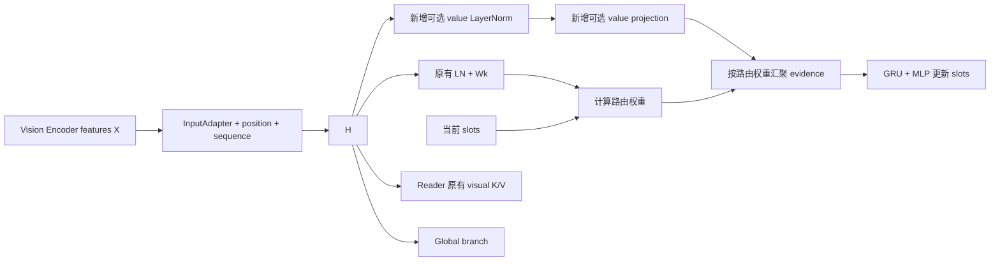

# BindFormer R1 / R2 / R3：可切换的空间路由与验证

日期：2026-10-20。实现对象：当前 `BindFormer3D`，保留四角色、UMLS concept memory、global branch、within-slot SA、local-reads-global CA 和报告生成 CE。

## 1. 要解决的具体问题

旧版多个 slot 的支持图、reader 实际读取和输出 token 高度相似。问题在前向初始化时已出现，并不只是训练很多 epoch 后的过拟合。本次处理的是这个结构退化，而不是直接加入 GREEN surrogate loss。

需要区分三件事：

1. **路由是否分工**：不同 slot 是否直接汇聚不同 patch。
2. **表征是否仍有差异**：经过 GRU、reader、SA+CA 和输出 MLP 后，差异是否保留。
3. **报告是否准确**：病灶、位置、尺寸、信号、强化等是否正确，GREEN/BLEU/ROUGE 是否提高。

固定区域可以在结构上保证第一点；本次短训测第二点；第三点必须通过完整训练后的报告评测验证。支持图正交不能单独证明临床语义已经学好。

## 2. 开关和推荐对照

所有配置都位于 `projector.params`，在 `configs/projector/bindformer3d.yaml` 中可见。所有新增开关默认关闭，保持旧路由。

| 配置 | 默认 | 作用 |
|---|---:|---|
| `router_value_normalization` | `false` | 对 router 聚合用的 value 做独立、逐 patch 通道 LayerNorm |
| `router_value_projection` | `false` | 可选独立 value 线性映射，初始化为单位矩阵；本次四组均关闭 |
| `fixed_spatial_regions` | `false` | 给每个 local slot 固定一个空间盒，同时约束 router 和 reader |
| `spatial_mean_aggregation` | `false` | 区域内均匀聚合 router evidence |
| `spatial_adaptive_aggregation` | `false` | 区域内根据 slot-query/patch-key 学习聚合权重 |
| `spatial_attention_temperature` | `1.0` | R3 区域内 softmax 的温度 |

| 实验 | value LN | 固定区域 | mean | adaptive |
|---|---:|---:|---:|---:|
| R0 原版对照 | 关 | 关 | 关 | 关 |
| R1 | 开 | 关 | 关 | 关 |
| R2 | 开 | 开 | 开 | 关 |
| R3 | 开 | 开 | 关 | 开 |

这四组是默认实验组合，并非把功能绑死。例如 R2/R3 可以单独关闭 value LN。开启固定区域必须且只能选择一种聚合；关闭固定区域时两种空间聚合必须都关闭。错误组合在读取配置时立即报错。

R2/R3 中不运行背景竞争；原版的 `background_slot` 设置仍保留在配置和参数布局中，便于对照。当配置背景 slot 为真时，空间模式跳过其初始向量，只使用后面的 K 个 local slot。输出 metadata 的 `background_slot=false` 表示有效行为；原版配置为真时则继续运行背景竞争。

## 3. R1：归一化具体放在哪里

对应 [overview PDF](figures/bindformer_overview/bindformer_overview.pdf) 中，从视觉表示 H 进入 slot binding、汇聚 evidence 后送入 GRU 的 **value 支路**。不修改 encoder，也不把 reader/global branch 的输入整体替换掉。



记 InputAdapter 输出为 \(H_i\)。旧版：

\[
K_i=W_K\operatorname{LN}_K(H_i),\qquad V_i=H_i.
\]

R1 默认：

\[
V_i=\operatorname{LN}_V(H_i).
\]

额外打开 `router_value_projection` 时：

\[
V_i=W_V\operatorname{LN}_V(H_i).
\]

也允许单独打开投影、关闭归一化。LN 有可训练的 affine 参数；投影无 bias，是共享于所有 patch/slot 的独立矩阵。**不是为每个 slot 配一套 value 网络**，也不是对 patch 维度做归一化。

独立 value LN 用来控制送入 GRU 的 evidence 尺度。不过，共享的 MRI sequence embedding、视觉特征公共方向和全图聚合并不会自动被 LN 去掉。它不能保证不同 slot 学到不同区域；应由实验判断是否足够。

## 4. R2：固定区域与平均聚合

### 4.1 不是把 207 个输出 slot 各分一块

8× 时 N=8775、总输出 M=1097、global tokens=273、local slots K=206，每个 local slot 产生四个 role token。旧版另外有一个不输出 token 的 background slot，因此竞争对象是 207 个。

空间模式划分的是 **206 个 local 区域**，不另划一个 background 区域。global branch 继续读取完整 H。

| 目标压缩率 | N | 输出 M | global tokens | local slots K |
|---:|---:|---:|---:|---:|
| 8× | 8775 | 1097 | 273 | 206 |
| 16× | 8775 | 549 | 137 | 103 |
| 32× | 8775 | 275 | 67 | 52 |

### 4.2 怎样精确分成 206 / 103 / 52 块

K 不一定能分解成规则的 D×H×W 网格，因此采用确定性的空间二分：

1. 从整个 patch grid 的一个长方体开始。
2. 取当前 patch 数最多的盒子；平局按坐标排序。
3. 在该盒子可切分的轴中，选择物理长度最长的一轴，在整数 patch 边界的中点切开。
4. 重复至恰好 K 个非空盒子，最后按坐标排序赋予 slot ID。

物理长度来自项目已有 `physical_extent()`，实际 BraTS grid 为 `[39,15,15]`，物理范围约 `[156,240,240]` mm。只有没有完整物理 metadata 的通用单元测试才退回单位 patch 间距。

每个 patch 恰好属于一个盒子；盒子是连续的 3D 空间区域；不使用报告、分割 mask 或病灶标签。数量只是近似均衡，不要求每个区域 patch 数相等。8× 的实际分组范围为 20–60 patches，均值 42.60。

这里保留完整 encoder 输入网格，**没有新增脑区前景筛选，也没有删去 encoder 输入 padding patch**。区域打包时为了对齐长度而添加的内部 padding，则会严格 mask 掉，两者不可混淆。

### 4.3 \(B_{ik}=1\) 的含义

\[
B_{ik}=\mathbf 1[i\in\Omega_k],\quad n_k=|\Omega_k|.
\]

B 表示归属，不直接表示概率。R2 的归一化 evidence 权重是：

\[
W_{ik}=\frac{B_{ik}}{n_k},\qquad E_k=\sum_i W_{ik}V_i.
\]

然后仍执行原来的三轮 `GRU(E_k, S_k) + MLP`。R2 的 E 对同一幅图在三轮之间不变，slot hidden state 仍会迭代。原有 Q/K 路由头在 R2 不参与计算，已设为不训练，避免优化无用参数。

**mean 只指 router evidence 平均。** 后续 role reader 仍按 role query 与区域 patch key 做内容注意力；四个 role 并非被强制平均读取。

两个非空、不重叠的支持向量点积为零，因此不可能继续出现“206 个 slot 直接读取同一份全图支持分布”。但正常组织或已融合上下文的 encoder 特征仍可能相似。

## 5. R3：固定区域内自适应聚合

区域划分和 R2 完全相同，只替换聚合权重：

\[
\ell_{ik}^{(t)} =
\frac{\langle W_K\operatorname{LN}_K(H_i),
W_Q\operatorname{LN}_S(S_k^{(t)})\rangle}
{\sqrt d\,\tau},
\]

\[
W_{ik}^{(t)}=
\begin{cases}
\dfrac{\exp\ell_{ik}^{(t)}}{\sum_{j\in\Omega_k}\exp\ell_{jk}^{(t)}} & i\in\Omega_k,\\
0 & \text{otherwise}.
\end{cases}
\qquad E_k^{(t)}=\sum_i W_{ik}^{(t)}V_i.
\]

softmax 沿 **本区域内的 patch 维度**。不是先限制每个 patch 只能访问一个 slot、再在 slot 维度 softmax；后者只会得到恒为 1 的权重，无法自适应。

每次 slot 更新重算 W，第三轮更新结束后再重算最终 W 供 reader 使用。Q/K、GRU、value LN 都由同一个报告 CE 反向传播训练。区域边界不学习，本次没有引入 mask/尺寸监督或其他 loss。

## 6. Reader 必须同步限制区域

旧 reader 使用：

\[
\alpha_{kri}\propto \exp\{\operatorname{score}(q_{kr},h_i)
+\beta_r\log(A_{ik}+\epsilon)\}.
\]

单纯把区域外 A 设为零，仍有 `log(epsilon)` 的有限值，不构成严格禁止。因此新路径只 gather 所属区域的 K/V，再对打包 padding 加 `-inf`。

空间 reader：

\[
\alpha_{kri}=\operatorname{softmax}_{i\in\Omega_k}
\{\operatorname{score}(q_{kr},h_i)+\beta_r\log(W_{ik}+\epsilon)\}.
\]

R2 中 W 在区域内均匀，其 log 项是常数，不改变区域内内容注意力。R3 的 W 是可学习支持先验。即使 `support_beta=0`，区域外访问也不会重新打开。

`assignments` 在空间模式下保存 B（occupancy），新增 `evidence_weights` 保存 W。两者不能混用：若将归一化 W 当 occupancy 计算几何体积，每个 slot 的权重和都是 1，区域大小会被抹掉。未来启用 `geometry_enabled` 时输入的是 B；它表达区域几何，**不是病灶分割体积**。

## 7. 跨区域大病灶如何处理

大病灶可以覆盖多个区域，由多个 slot 分别保留其局部证据。当前仍有：

- 全图 NeuroVFM encoder：每个输出 patch 已可能包含全图上下文；
- global branch：读取全图；
- local-reads-global CA：将全局信息传给各 local bundle；
- Llama decoder：可综合多个区域 token。

所以这里限制的是 projector 的**直接 patch 读取范围**，不是把图像切成互不通信的独立 encoder 输入。

上述通路可以帮助整合大病灶，但没有显式“将多个区域归并成同一病灶实例”的约束。当前 within-slot SA 只让同一 slot 内的 role 交互；未新增跨 local slot 的邻接注意力、实例关联或病灶级 pooling。病灶跨区尺寸和体积的一致性还需要完整任务验证，必要时再单独加入实例级机制和监督。

## 8. 代码入口与兼容性

| 文件 | 修改 |
|---|---|
| `src/models/projectors/bindformer/config.py` | 开关默认值、互斥验证、旧 checkpoint contract 的默认扩展裁剪 |
| `src/models/projectors/bindformer/slots.py` | 独立 value 支路、区域均值/区域内 softmax、三轮 GRU |
| `src/models/projectors/bindformer/regions.py` | 精确 K 个空间盒、打包索引、B/W 的 dense 映射 |
| `src/models/projectors/bindformer/reader.py` | 仅 gather 区域 K/V，严格 padding mask |
| `src/models/projectors/bindformer/projector.py` | 模式选择、geometry occupancy、metadata |
| `src/models/projectors/bindformer/types.py` | evidence、region 索引、SA+CA 前 role tokens 诊断通道 |
| `scripts/smoke_bindformer_routing.py` | 真实报告 CE 短训和 FP32 逐层复测 |
| `tests/test_bindformer_routing.py` | 隔离、覆盖、数学对照、梯度、checkpoint 测试 |
| `tests/test_bindformer_routing_launchers.py` | 与 1019 脚本的完整训练配置逐项比较 |

新可选模块在整个旧核心及 SA+CA 初始化完之后才创建。全部关闭时不新增参数，不消耗额外初始化随机数；旧权重可 strict load，输出通过修改前快照的逐位一致性检查。

开启新结构应启动新实验，不应把更改开关当作旧 run 的 resume。checkpoint 中保存解析后的开关；resume/evaluation 以保存配置为准。四组的公共 projector 初始参数另有 SHA256 比较记录。

## 9. Smoke test 协议与指标

物理 GPU 3，内部设备 `cuda:0`。四组使用同一 seed=42、同一 48 个训练 volume、同一数据顺序，都是 SA+CA、8×、三轮 slot 更新、真实 NeuroVFM + frozen Llama-3-8B，loss 为报告 answer CE。Encoder 进入联合阶段后训练视觉 LoRA，**不是只跑随机张量或冻结特征的替代任务**。

为了在短窗口内覆盖阶段切换，smoke 使用：

- 12 个 optimizer steps；
- microbatch=1，effective batch=4；
- projector warmup=2，joint warmup=2，其后恒定 LR；
- projector/encoder peak LR 均为 2e-4；
- 不生成报告、不调用 GREEN；结束时计算固定 9 个验证 volume 的 CE。

这三项缩小的设置不进入正式 launcher。正式训练仍是 effective batch=16、77+77 warmup、最多 20 epochs。

在 step 0、1、4、12，用 GLI/MEN/MET 各 3 个固定验证 T1C 病例复测。注意原 schedule 的 warmup 起点 LR=0，因此 step 1 与 step 0 相同是预期行为；step 4/12 包含真实非零参数更新。

probe 使用 encoder 原始 BF16 执行、projector FP32、eval/inference 模式；保存并恢复 RNG 和训练模式，避免探针对训练随机过程产生影响。每个病例记录：

1. 每轮 slot 更新前后，local slot 两两余弦均值。
2. 支持图两两余弦与有效秩。
3. R0/R1 patch→slot 归一化熵；R2/R3 另测区域内权重熵。
4. evidence 方向和范数、H/value 范数。
5. 显式重建 reader 多头 softmax，与真实 reader 输出核对误差。
6. 每个 role 的 reader 注意力图相似度、reader 输出相似度，以及 SA+CA 后相似度。
7. 最终 local Z 的余弦与相对离散度。
8. router 参数梯度及 encoder/projector 实际优化更新。

给定行向量矩阵 Y，相对离散度：

\[
\operatorname{spread}(Y)=\frac{\|Y-\operatorname{mean}_{row}Y\|_F}{\|Y\|_F}.
\]

支持图有效秩：先将每个 slot 的支持图做 L2 归一化，再对奇异值归一化为 p，计算 \(\exp[-\sum p\log p]\)。归一化、Gram 矩阵和特征值分解均使用 FP64，避免近似秩一时小特征值被 FP32 舍入噪声放大。因此 R2/R3 的不重叠支持图有效秩必然为 K；这是结构检查。最终 Z 的余弦/离散度才检验这种分工是否被后续映射抹掉。

这个补充有效秩指标与旧 `probe.py` 使用的“未归一化支持矩阵的平方奇异值能量熵”口径不同，不应把两份有效秩数字直接做纵向对比。支持图余弦、slot 余弦、实际 reader 注意力和输出差异沿用之前的诊断思路。

### 实测结果

四组均完成 12 步，未出现非有限 loss/gradient。以下是第 12 步、9 个验证病例均值：

| 组别 | slot 余弦 | 支持图余弦 | 最终 local Z 余弦 | Z 相对离散度 | 9 病例 val CE |
|---|---:|---:|---:|---:|---:|
| R0 原版 | 0.999902 | 0.9999977 | 0.9999999991 | 0.00003063 | 2.3044 |
| R1 value LN | 0.999885 | 0.9999973 | 0.9999999987 | 0.00003553 | 2.2700 |
| R2 空间均值 | 0.979969 | 0 | 0.9984968795 | 0.03894585 | 2.3468 |
| R3 空间自适应 | 0.986856 | ≈0 | 0.9989888041 | 0.03201129 | 2.2657 |

**结论：R1 单独不能解决问题；R2/R3 对“所有 slot 直接汇聚同一份全图分布”有效，但未彻底解决下游表征趋同。**

- R2/R3 的支持图和实际 reader 注意力图跨 slot 余弦都为 0（浮点容差内），不只是 router 的一个中间矩阵看起来分开。
- 最终 Z 离散度分别是原版约 **1271× / 1045×**，说明分工确实传到最终输出，而非完全被后续模块抹掉。
- 但两者最终 Z 余弦仍分别约 **0.9985 / 0.9990**。R2 离散度从初始化的 0.3543 降到第 4 步的 0.1625，再降到第 12 步的 0.0389；R3 为 0.3550 → 0.1649 → 0.0320。短训中仍明显向公共方向收缩。
- R3 区域内权重归一化熵约 **0.9980 → 0.9847 → 0.8952**，表明其聚合并非一直等价于均值。第 12 步 Q/K 梯度范数分别约 **4.09e-4 / 5.23e-4**；R2 的 Q/K 不使用且已冻结，梯度为 `None` 是预期行为。
- 四组 encoder LoRA 和 projector 都测到实际非零参数更新；decoder 保持冻结。显式重建 reader 与真实输出的最大相对误差小于 **1.6e-6**。

下游差异缩小发生在哪里，可以从第 12 步的数值看得更清楚：

| 相似度位置 | R2 | R3 |
|---|---:|---:|
| 区域 evidence | 0.87944 | 0.88454 |
| GRU 三轮后 slot | 0.97997 | 0.98686 |
| reader 输出，同 role 跨 slot | 0.98177 | 0.98633 |
| SA+CA 后，同 role 跨 slot | 0.98992 | 0.99253 |
| 输出 head 后全部 local Z | 0.99850 | 0.99899 |

最后一行统计全部 local role tokens，前两行按 slot，reader/SA+CA 行按同 role 跨 slot；不要将相邻行的差值当作严格的单模块因果贡献。不过，区域 evidence 仍明显不同、输出逐渐高度相似，足以说明“区域读错/全部读同一区域”不再是唯一需要检查的环节。后续若长训继续收缩，应分别对 GRU 更新、共享 context 与最终映射做对照；本次没有擅自新增 diversity loss 或改写 SA+CA。

高余弦本身也不等于“完全没有信息”：decoder 可能利用小幅方向差异或范数差异。因此不能只为了降低余弦而优化，更不能由这些数字推断 GREEN 已提高。


R2 是更直接的固定分工对照；R3 用于检验区域内学习权重是否有额外价值。当前短训不能证明 R3 优于 R2，也不能用这 9 个病例的 CE 排正式优劣。当前入口按全图路由、固定区域均值、固定区域自适应聚合命名，并各提供 SA+CA 与 vanilla 两版。R1 的独立训练入口已按用户要求移除，历史结果仍保留在本报告。

### 验证范围与结果文件

- **110 项 CPU 测试通过**：旧路径、梯度、checkpoint、budget、feature loss 集成、sweep，以及新路由和 launcher 配置。
- **8 项 GPU 测试通过**：GPU 3、完整 8775×768 输入、4096 输出维度、BF16、checkpoint、SA+CA；覆盖 R2/R3 的 8/16/32×，并额外验证关闭 value LN 的 32×组合。
- 关闭新开关时，与修改前 SA+CA 快照的参数初始化、state_dict keys、前向输出逐位一致；所有四组公共初始化 SHA256 相同。
- 使用真实数据 `--dry-run` 检查完整 R3 计划：1960 train / 268 val / 560 test；三种压缩率；最多 2460 optimizer steps；其余训练参数与参考脚本一致。CPU launcher 测试逐项对照了四组与原版配置。
- GPU 3 的 smoke 峰值已分配显存约 18.1–18.2 GiB。全部测试已结束，没有启动完整训练。

完整证据目录：[`results/BindFormer_routing_1020_smoke`](../results/BindFormer_routing_1020_smoke/)。

| 文件 | 内容 |
|---|---|
| `summary.json` / `summary.csv` | 按组、按训练步汇总的指标与一致性检查 |
| `routing_smoke.png` / `routing_smoke.pdf` | 可查看/导出的曲线 |
| `r*/routing_probe.json` | 逐病例、逐训练步、逐 slot 更新轮次的诊断 |
| `r*/train.jsonl` / `validation.jsonl` | 真实报告 CE 训练及验证记录 |
| `r*/routing_gradients.json` | router 各参数梯度 |
| `r*/optimizer_diagnostics.jsonl` | encoder/projector 参数实际更新 |
| `r*/checkpoints/last.pt` | 第 12 步可复查 checkpoint |
| `r*/smoke_protocol.json` / `reprobe_protocol.json` | 初始参数哈希、代码哈希、复测说明 |
| `r3_full_plan.json` | 真实数据上的完整训练 dry-run 计划 |
| `cuda_acceptance.log` | 完整尺寸 GPU 测试输出 |
| `aggregate.py` | 从记录重建 summary 和图 |

有效秩改用 FP64 Gram 后，另从完全相同的初始参数及保存的 step 4/12 checkpoint 做了无训练复测。原始训练中记录保留为 `routing_probe_initial_fp32_gram.json`。R0/R1/R2 输出余弦复测完全一致，R3 全部复测记录的最大差异约 4.3e-6，不影响上述结论；表中采用复测记录。

本次**没有**评测 BLEU、ROUGE、GREEN，也没有验证收敛后效果、其他随机种子或其他模态的短训稳定性。12 步训练只覆盖 8×；16×/32×覆盖完整尺寸前反向和配置检查，不等同于已完成它们的短训。

## 10. 正式运行

目录：`scripts/ft_ablation/Exp1020/`。六个入口均去掉日期，以路由含义命名：

| 路由方式 | SA+CA 入口 | Vanilla 入口 |
|---|---|---|
| 全图竞争路由（原 R0） | `run_bindformer_saca_global_routing_constlr.sh` | `run_bindformer_va_global_routing_constlr.sh` |
| 固定区域＋均值聚合（原 R2） | `run_bindformer_saca_fixed_region_mean_constlr.sh` | `run_bindformer_va_fixed_region_mean_constlr.sh` |
| 固定区域＋自适应聚合（原 R3） | `run_bindformer_saca_fixed_region_adaptive_constlr.sh` | `run_bindformer_va_fixed_region_adaptive_constlr.sh` |

`global_routing` 表示所有 slot 都可读取全图 patch，仍有竞争软分配和 global/local 两类输出，不表示只保留 global tokens。`fixed_region_adaptive` 的区域边界固定，自适应的是区域内聚合权重。R1 独立入口移除；原 R2/R3 配方中的 value 归一化仍默认开启并可单独关闭，没有因重命名而改变已测试配方。新增 vanilla 入口是训练配置，尚无对应的固定区域短训或正式训练结果。

公共训练设置与 1019 对应的 SA+CA/vanilla baseline 对齐：8/16/32×、projector/encoder LR=2e-4、20 epochs、seed 42、77+0+77 schedule、hold_peak、恒定 LR、early stopping patience=3/min_delta=.005、有效 batch=16、LoRA rank=16/alpha=32、四角色各一个 query、global fraction=.25、slot iterations=3、UMLS `brats_train`、所有辅助 loss=0。SA/CA 按 `saca`/`va` 入口分别开启/关闭。

每个压缩率独立从预训练资产开始，训练后自动对 best.pt 做完整 test/all metrics，再进入下一个压缩率。默认 GPU=3，允许 `CUDA_VISIBLE_DEVICES` 覆盖；不会继承 smoke 的 checkpoint 或样本限制。

六个入口均与 1019 baseline 的书写形式一致：各自显式列出 GPU、ratio 数组、学习率、epochs、batch、LoRA rank/alpha、warmup、early stopping、SA/CA、head 类型和路由开关。直接编辑对应 `run_*.sh` 即可；`_common_constlr.bash` 只组装命令并在 run tag 留空时生成名称，不会重置入口中的训练参数。自动生成的运行目录名称保留时间戳，用于区分重复实验；启动脚本文件名不含日期。

例如，在 R2 入口中将 `projector_ratios=(8 16 32)` 改为 `projector_ratios=(8)`，即可只跑 8×；GPU 行中的 `${CUDA_VISIBLE_DEVICES:-3}` 表示外部环境变量优先，没有设置时才使用文件中的默认卡号 3。已 export 该变量的 tmux shell 中，编辑默认卡号不会覆盖外部值，应同步调整外部环境变量。

`saca` 入口的 `bind_within_slot_sa`、`bind_local_reads_global` 均为 true；`va` 入口均为 false。同一路由的两版除这两个开关和运行名称外，配置一致。两个开关仍可分别编辑；若改成仅 SA 或仅 CA，可同步编辑 `bind_variant`，或自定义 `projector_run_tag`/`--run-tag`。`bind_head_type=mlp` 保持原来的两层 head，`linear` 是额外的输出映射消融。已有 `bind_feature_loss_weight` 仍对应全 global+local 重建，尚不是第 12 节提出的区域监督。

在 tmux 的 shell 中运行，例如 R2：

```bash
cd /mnt/sda/jyzhang/VLM_Projector
export PROJECTOR_PYTHON=/mnt/sda/mingjie/conda_envs/projector/bin/python
export CUDA_VISIBLE_DEVICES=3
bash scripts/ft_ablation/Exp1020/run_bindformer_saca_fixed_region_mean_constlr.sh
```

原 R3 使用对应的 `fixed_region_adaptive` 文件；vanilla 使用 `va` 文件。需要只运行 8×，在末尾添加 `--ratios 8`；只检查配置，添加 `--dry-run`。

开关示例：R2 不使用 value LN：

```bash
BIND_ROUTER_VALUE_NORMALIZATION=false \
bash scripts/ft_ablation/Exp1020/run_bindformer_saca_fixed_region_mean_constlr.sh --ratios 8
```

也可从同一个文件切换 mean/adaptive，确保同时关闭原聚合、打开新聚合：

```bash
bash scripts/ft_ablation/Exp1020/run_bindformer_saca_fixed_region_mean_constlr.sh \
  --set projector.params.spatial_mean_aggregation=false \
  --set projector.params.spatial_adaptive_aggregation=true
```

此时 run tag 仍来自入口文件的 `fixed_region_mean` 名字；自定义组合应同时传 `--run-tag 自定义名称`，具体结构以 `sweep_plan.json` 和 `resolved_config.yaml` 为准。完整退回旧路由直接运行 `global_routing`。

复现 smoke：

```bash
CUDA_VISIBLE_DEVICES=3 PYTHONPATH=. PYTHONNOUSERSITE=1 \
CUBLAS_WORKSPACE_CONFIG=:4096:8 OMP_NUM_THREADS=4 MKL_NUM_THREADS=4 \
PYTORCH_CUDA_ALLOC_CONF=expandable_segments:True \
/mnt/sda/mingjie/conda_envs/projector/bin/python -u scripts/smoke_bindformer_routing.py \
  --variant r3 --steps 12 --batch-size 4 --output results/another_routing_smoke/r3
```

不要复用已经完成训练的 smoke 输出目录；脚本会拒绝覆盖。

## 11. 补充解释：离散度会不会再次趋近零，高余弦来自哪里

### 11.1 指标的定义和边界

对单个 volume 的全部 local 输出，令 \(Z\in\mathbb R^{T\times4096}\)，8× 时 \(T=206\times4=824\)，不包括 global tokens。每一行是一个 local token，先沿 token 维计算均值：

\[
\bar z=\frac1T\sum_i z_i,\quad
\rho=\frac{\|Z-\mathbf1\bar z^\top\|_F}{\|Z\|_F}.
\]

先按病例计算，再在 9 个病例上求均值。这是代码中用于监测输出趋同的诊断量，不是报告评价指标，也没有加入训练 loss。

对非零 Z，\(0\leq\rho\leq1\)。所有行相同时为 0；大一些表示相对于整体幅度有更多 token 间差异。随机噪声、固定位置编码也能增大它，所以不应把它单独最大化。

可以将其拆成三个有物理量纲一致性的范数：

\[
M=\|\bar z\|_2,\qquad
D=\sqrt{\frac1T\sum_i\|z_i-\bar z\|_2^2},\qquad
Q=\sqrt{\frac1T\sum_i\|z_i\|_2^2}.
\]

\[
Q^2=M^2+D^2,\qquad \rho=D/Q.
\]

M 是同一幅图各 token 的公共分量，D 是 token 相对本图均值的绝对差异幅度。公共分量可以随图像变化，不能把 M 理解成所有患者共享的常数。

R2 的 0.03895 表示差异 RMS 范数约为整体 RMS 范数的 3.895%。其平方约 0.15% 是中心化差异的平方范数占比，**不是“仅剩 0.15% 的病灶信息”**。低幅度信号也可能包含诊断信息，是否被 decoder 利用需要任务消融。

若各 token 范数相等，令 \(\bar c\) 为非对角两两余弦均值，则精确满足：

\[
\rho^2=\frac{T-1}{T}(1-\bar c).
\]

因此 0.9985 的余弦与约 0.039 的离散度是一致的；两项不能当作完全独立的有效性证据。“离散度提高三个数量级”也不意味着语义信息或报告质量提高三个数量级。

### 11.2 长训是否会回到原版水平

R2 为 0.3543→0.1625→0.0389，R3 为 0.3550→0.1649→0.0320，分别对应 step 0/4/12。两组在这个短窗口内都继续下降，没有稳定平台证据。

不能据此断言将降到 3e-5，也不能保证不会。固定区域保证直接读取的 patch 集合不同，不能限制后续可学习映射把差异压掉。目前没有显式保留各区域内容或监督各区域语义的目标。未来评估应同时看 M、D、rho，而不是仅看 rho；更应检查 decoder 是否真正利用区域差异。

### 11.3 追加的只读实测

补充脚本：[`probe_collapse_components.py`](../results/BindFormer_routing_1020_smoke/probe_collapse_components.py)。
结果：[`collapse_components.json`](../results/BindFormer_routing_1020_smoke/collapse_components.json)。

在 GPU 3 上恢复 R0/R2/R3 的 step 4、step 12 checkpoint，各跑同一批 9 个验证 T1C volume；无 decoder、无训练、无 checkpoint 修改。encoder BF16，projector FP32。reader 到 head 的所有层统一比较同样的 824 个 local tokens，并另外记录同 role 跨 slot 指标。

R2 的绝对幅度：

| 位置 | step 4 公共 M | step 12 公共 M | step 4 差异 D | step 12 差异 D |
|---|---:|---:|---:|---:|
| reader 输出 | 13.39 | 27.21 | 3.75 | 3.81 |
| 最终 local Z | 18.01 | 39.93 | 2.97 | 1.56 |

这说明 reader 处离散度下降主要伴随公共分量增长，区域差异的绝对幅度并未明显下降；最终输出则同时出现公共分量增长与绝对差异缩小。仅凭高余弦说“区域内容已经全部消失”不准确。

R3 对应 reader 的 M 为 13.30→29.73，D 为 3.78→3.60；最终 Z 的 M 为 18.00→37.70，D 为 3.01→1.21，趋势相近。

第 12 步，统一使用全部 824 个 local tokens 的两两余弦：

| 位置 | 维度 | R2 | R3 |
|---|---:|---:|---:|
| reader | 768 | 0.981836 | 0.986384 |
| within-slot SA 后 | 768 | 0.989540 | 0.992284 |
| global CA 后 | 768 | 0.989960 | 0.992560 |
| final LayerNorm 后 | 768 | 0.989982 | 0.992578 |
| head 第一层 Linear 后 | 4096 | 0.993002 | 0.994851 |
| head GELU 后 | 4096 | 0.993122 | 0.995257 |
| head 最后一层 Linear 后 | 4096 | 0.998497 | 0.998989 |

在同样 4096 维内，最后一层映射继续提高了方向相似度。因此“维度高”不能解释这里的高余弦。独立、各向同性随机单位向量的余弦均值为 0，方差为 1/d；高维不会自然使余弦趋近 1。学习后的表示可以形成偏向共同方向的各向异性分布，相关现象也见于 [Ethayarajh, 2019](https://aclanthology.org/D19-1006/)，但该文不能直接证明当前 VLM 的表示是否有用。

LayerNorm 对每个 token 的通道归一化，并不减掉跨 token 的公共向量；多个相同向量经过 LayerNorm 后仍然相同。

为避免过早归因，针对同一个已训练模型还做了三种前向干预：

| 最终输出余弦 | R2 | R3 |
|---|---:|---:|
| 原路径 | 0.998497 | 0.998989 |
| 去除最后一层 Linear bias | 0.998494 | 0.998987 |
| 绕过 global CA | 0.998428 | 0.998948 |
| 同时绕过 SA、CA | 0.997092 | 0.997899 |

所以公共方向并不只是最后一个 bias 造成，单独 global CA 也不是当前快照中高余弦的主要解释。SA 和输出 head 值得继续检查，但这些是固定权重的前向干预，不等于重新训练后移除模块的效果，更没有证明这些干预能改善报告质量。

要判断区域差异是否真正被使用，可保持 global tokens 不变，将 local tokens 全部替换为本图 local 均值，比较原图与替换后的 teacher-forced CE、生成报告中的位置/侧别/大小变化；也可交换不同病例的 local tokens 做图像依赖性对照。单纯重排 local token 顺序会同时扰动位置编码，应与内容替换区分。上述任务消融尚未执行。

## 12. 为什么固定区域之后仍会趋同，以及下一步如何保留区域内容

本节是依据现有代码和第 11 节保存的诊断提出的设计建议。**本节没有新增训练，没有实现新的 loss、残差路径或改动 R2/R3 启动参数。**已有测试只证明分区读取有效、12 步时输出差异大于 R0，不能证明长期训练不会趋同，也不能证明报告质量提升。

### 12.1 硬约束究竟约束在哪里

当前主要视觉 value 路径为：

```text
H 中本区域的 patch
    → Reader 的区域内 attention、value/output projection、FFN
    → 本 slot 四个 role 之间的 SA
    → 本 slot 从 global tokens 读取上下文的 CA
    → 逐 token LayerNorm
    → 共享的 Linear–GELU–Linear head
    → 最终 local Z
```

Router 的 evidence/GRU 产生 slot，再通过 concept/role 模块影响 Reader query；它不是上图视觉 value 必须依次经过的一个压缩层。硬区域索引约束 Router 的聚合范围和 Reader 的直接 K/V 来源。H 本身来自具有上下文的视觉编码器，因此这里的“局部”是 patch 索引意义上的来源限制，不是对原始像素感受野的完全隔离。

- **Reader 的支持不重叠，不等于读取的数值不同。**不同区域可以包含相似组织；共享的 value/output 映射也可以弱化区域差异。
- **SA 没有把 206 个 slot 混在一起。**当前 SA 只在每个 slot 的四个 role 内操作。但共享映射和共同分量的增强，仍可能使不同 slot 的输出更接近。
- **CA 可以给多个 slot 添加相似的全局上下文。**残差保留原输入的加法项，并不限制新增上下文的幅度，也不保证后面的映射保留该输入。
- **逐 token head 没有显式的跨 slot 平均操作，但可以把不同输入映射到接近的输出。**例如两个向量的差异主要在某个方向，线性层在该方向上的增益很小时，输出差异就会很小。扩大输出维度不保证该增益大于零。

因此，“没有约束后面的网络保留差异”指的是：目前既没有保证映射保留距离的结构条件，也没有要求最终每个 local bundle 能预测自己区域内容的训练目标。

### 12.2 当前快照支持什么归因

下表统一统计同一批验证病例的 824 个 local tokens，值为相对离散度，step=12：

| 位置 | R2 | R3 |
|---|---:|---:|
| Reader 后 | 0.138627 | 0.120097 |
| slot 内 SA 后 | 0.105133 | 0.090054 |
| global CA 后 | 0.102997 | 0.088443 |
| 最终 head 后 | 0.038946 | 0.032011 |

Reader 之后仍有明显的差异，最终 head 后相对差异进一步缩小。跨训练步看，R2 Reader 的绝对差异 D 从 step 4 的 3.75 到 step 12 的 3.81，基本保留；最终 Z 的 D 则从 2.97 降至 1.56，同时公共分量 M 从 18.01 增至 39.93。这比仅观察余弦更能说明问题。

这些结果说明当前需要检查后续映射，并不证明某一层造成了不可逆的语义丢失。不同层尺度不同，不能仅以跨层绝对范数大小判定信息多少。单独绕过 CA 时 R2 最终离散度只由 0.03895 变到 0.03983，也不支持把当前现象全部归因于 CA。第 11 节的前向干预不是重训练消融。

当前四组 smoke 和 Exp1020 默认启动配置均为 CE-only，`feature_loss_weight=0.0`。报告 CE 不要求每个 slot 独立携带区域内容；利用 global 和文本上下文也可能降低 CE。这是目标函数允许的解释，目前尚未通过 decoder 干预证明模型实际采用了哪条路径。

CE 本身没有让不同 token 相等的目标项，所以不能说“CE 必然导致坍缩”。当前观测是：在这套结构、数据和 CE-only 优化设置下，训练伴随最终 local 表示趋同。若不同 slot 获得相近的任务梯度，且区域差异对当前预测收益较小，优化可能强化公共分量并弱化差异；这是待验证的机制解释。现有探针从 Reader 输出开始，尚未逐一分离 Reader 内的 value projection、attention、output projection 和 FFN，因此不能确定趋同最早发生于其中哪个具体操作。空间上的第一次显式跨区域上下文引入是 global CA，而数值上的趋同在它之前已经存在。

### 12.3 优先增加最终 local 输出的区域内容监督

现有 `FeatureReconstructor.predict()` 把传入的全部 embeddings 当作 memory；调用方传入 global+local 的最终输出。它约束整组 token 的可重建性，**没有约束某个区域必须由属于该区域的 slot 重建**。此外，坐标 query 自带残差，可能利用位置/序列先验；这是结构上允许的捷径，不能据此认定已经发生。

建议先实现一个轻量、可独立开关的区域特征监督，再视需要增加逐 patch 重建：

1. 对最终 head 之后的 `Z_local[k, 4, 4096]` 做 role 均值，得到每区域的最终输出摘要。
2. 从 frozen teacher 的同一区域提取目标特征摘要，stop-gradient；保持既有 teacher，避免同一次实验同时改 teacher 和监督范围。
3. 一个所有区域共享的线性 readout，从最终输出摘要预测 teacher 摘要。readout 不接收 global、其他 slot、坐标、slot ID 或原始 H。
4. 为避免只放大极小的残差来完成重建，使用 L2 归一化的输入摘要、归一化的 teacher 目标，并对 readout 的算子范数加上界。不要在 readout 输出端再做可抵消幅度的归一化。

一个待实现的目标为：

\[
\bar z_k=\frac1R\sum_r Z_{kr},\quad
u_k=\frac{\bar z_k}{\|\bar z_k\|_2+\epsilon},\quad
t_k=\operatorname{sg}\!\left[
\operatorname{normalize}\!\left(\operatorname{Pool}_{i\in\mathcal R_k}
X_i^{teacher}\right)\right],
\]

\[
\mathcal L_{\mathrm{region}}=\frac1K\sum_k\|A u_k-t_k\|_2^2,\qquad
\|A\|_2\le s,\quad s>0.
\]

Pool 应按有效 patch 体积分数加权；实现时需要明确排除没有有效内容的区域。这里的 normalize 是 L2 归一化，与现有 L_feat 的逐 patch LayerNorm 不同。s 是预先确定并记录的 readout 增益上界，不在本节指定尚未验证的最优数值。

这个设计的作用可以精确表述：若某个样本两个区域的预测误差分别不超过 e_i、e_j，则

\[
\|u_i-u_j\|_2\ge
\max\left(0,\frac{\|t_i-t_j\|_2-e_i-e_j}{s}\right).
\]

当 teacher 区域内容不同且预测误差足够小时，完全相同的最终输出摘要无法满足该目标。这是有条件的约束，不代表训练一定能达到低误差，也不保证 teacher 的差异对应诊断所需属性。相似的正常区域无需被强迫分开。

区域均值可能稀释小病灶，也不约束四个 role 分别学到什么。进一步的 `local_only` patch 重建应让每个 patch 的查询只访问其所属 slot 的四个最终 token：

\[
\hat X_i=D_\phi(Z^{final}_{k(i),1:R},c_i).
\]

该版本不读取 global 或其他区域，且不允许 H 直接进入重建器。坐标可以协助解码区域内部布局，但必须增加同序列、同区域、跨患者替换 token 的验证，检查重建是否真的依赖图像内容，而非位置先验。

以上两种监督都应加在最终 head 之后；只监督 Reader 仍允许后续 head 丢掉局部差异。先比较 CE 与 CE+区域监督，再决定是否增加逐 patch 重建，避免一次混入多个无法归因的改动。

### 12.4 结构上的辅助方案：最终输出处保留局部路径

如果区域监督仍不足，可增加可关闭的局部残差分支：

\[
Z_{kr}^{local}=P_{\rm local}(l_{kr})+
\alpha_{kr}\,\widetilde C_{kr},
\]

其中 l 是交互前 Reader 输出，P_local 映射到 LLM 维度，C 是交互分支输出；约束上下文项相对于局部项的范数，并限制门控幅度。融合应发生在最终输出位置，避免融合之后再经过一个无约束的共同 MLP。

这个分支保留了一条短的局部内容路径，但**单独残差连接不是不坍缩的数学保证**：P_local 仍可能忽略局部差异，两个分支也可能相互抵消。因此仍需监督融合后的最终 Z。把固定位置编码放大以降低余弦，也不能替代保留图像内容。

### 12.5 下一轮验证标准

建议先用 R2 做控制变量对照：原 CE-only、仅增加最终区域监督；SA/CA 开关和线性 head 作为独立消融，局部残差分支后置。短训后延长到至少覆盖 50/100/200 个 optimizer steps，并保持相同训练预算、样本顺序和验证病例，覆盖完整 schedule 后再判断长训。

需要同时记录：

- 区域支持仍然互斥，以及同 role 跨 slot 的相似度。
- Reader 和最终输出的 M、D、rho，不能只看余弦。
- teacher 区域预测误差，以及输入最终 token 相比常量/错配 token 的预测收益。
- 固定 global，仅替换 local 的报告 CE 和生成事实变化。均值对照优先按 role 跨 slot 取均值再回填，保留 role 间差异；错配对照优先同序列、同区域跨患者替换，控制区域身份和局部 token 尺度；事实检查包括侧别、位置、大小和水肿。

高离散度只能说明表示不同；只有正确图像的 local 内容比均值或错配内容更有助于目标预测，才能支持“模型使用了局部信息”。对位置、大小等属性仍需专门标注或可靠事实抽取评价。

参考：[VICReg](https://arxiv.org/abs/2105.04906) 通过显式方差/协方差约束处理表征坍缩；这里不能直接把跨样本的约束照搬成“同一张脑图所有区域必须互相正交”。[MAE](https://arxiv.org/abs/2111.06377) 使用重建目标学习视觉表示；上面的最终 token 区域限制和 readout 增益约束是针对当前代码提出的方案，不是这两篇论文已经验证过的 BindFormer 结论。

## 13. 正式 16× checkpoint 复核（区别于前述 12 步 smoke）

完整结果见 [16× 诊断 Markdown](../results/BindFormer_fixed_region_r16_diagnosis/diagnosis.md) 和 [HTML](../results/BindFormer_fixed_region_r16_diagnosis/diagnosis.html)。本次使用已经完成的旧路由 VA/SA+CA、固定区域均值 VA/SA+CA 的 best checkpoint，未新增训练，也未实现第 12 节提出的 loss 或残差分支。

- 四组 best 都对应完整 268 条验证报告的最低 CE；固定区域 VA/SA+CA 分别是 epoch 8/9。训练监测的 14 条生成报告仅来自 4 位患者，不能据此可靠重选生成质量最优 checkpoint。
- 在相同 9 位验证患者、四序列共 36 个 volume 上，固定区域两组实际读取支持不重叠，103 个支持列的有效秩为 103。最终 local 相对离散度：旧 VA 0.0009408、旧 SA+CA 0.0000143、固定区域 VA 0.0898034、固定区域 SA+CA 0.0385931。范围限制与表示差异的改善在正式训练后仍然存在。
- 在这 9 位患者的 T1C 上，保留 global、按 role 将 local 替换为跨 slot 均值，固定区域 VA/SA+CA 的 answer-token 加权 CE 差分别约 +0.00045/−0.00103，未显示稳定的退化。它只说明该小样本、teacher-forced CE 下尚缺少有效利用区域差异的证据，不证明模型完全不使用图像。
- 四组共同成功的 553 条 GREEN 结果显示：固定区域 VA 主要减少遗漏、增加匹配发现；固定区域 SA+CA 主要减少虚构描述，位置错误未同步改善。SA+CA 在固定区域下的 GREEN 点估计下降，患者配对区间仍跨 0；RadGraph Simple 下降的区间不跨 0。所有比较均仅一个训练 seed。

该复核进一步区分了“空间分工成立”“最终表示保留差异”和“Decoder 用差异生成正确事实”三个层面，后两者不能仅由支持图正交推出。
