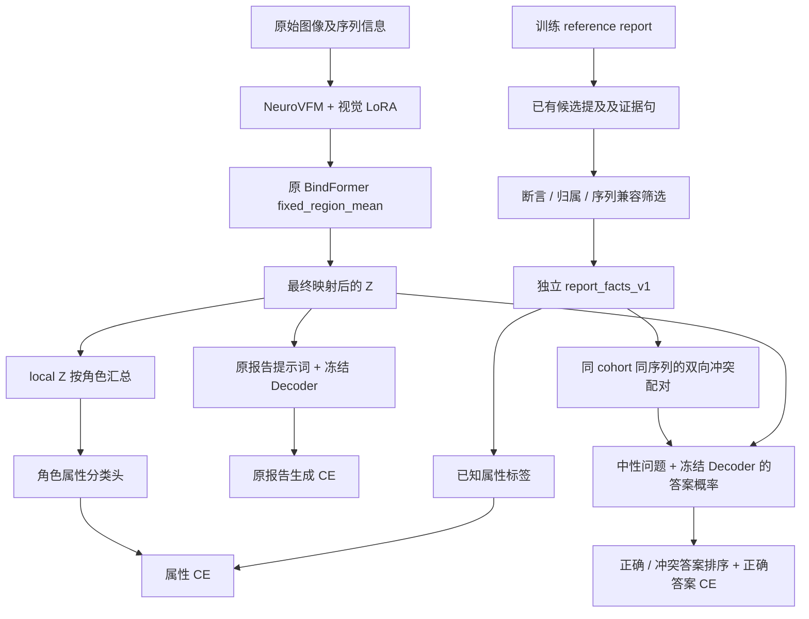

# Report Facts v1：基于 reference report 的属性与 Decoder 配对监督

更新日期：2026-10-22。本文记录当前已实现代码、默认实验设置及核查结果；尚无这六个正式实验的训练收益结论。文中路径以项目根目录为基准，链接使用相对此文档的位置。

最新配置变更：按用户要求，标准脚本及 GPU 2 / 32×、GPU 3 / 64× 专用脚本默认关闭 `margin` 边界辅助监督，启用字段为 `[edema,laterality,site,signal]`。**morphology/extent 暂时没有独立属性监督**，四角色 token 结构和原报告 CE 保留；其余训练设置不变。

## 1. 目标与实验边界

在现有报告生成 CE 的基础上，检验两种附加监督能否改善图像条件下的事实表达：

- E1：让输入 Decoder 的最终 local Z 携带相应角色的报告属性。
- E2：让冻结 Decoder 在同一幅图像条件下，更倾向于正确事实答案，而不是冲突答案。
- E3：同时使用以上两项监督，判断表征监督与 Decoder 配对监督是否互补。

新增标签全部来自训练 reference report，复用已有候选提及并进行保守规则筛选。不使用 segmentation 作为新增监督，也不预测病灶中心、体积或像素轮廓。按当前任务约定，原 manifest 对 mask 路径的要求不做修改；原 Dataset 的调用保持不变。

第一版是病例级、单病灶文本语境下的弱监督。它没有建立“固定区域—真实病灶实例”的对应关系，不能据此宣称实现了多病灶的精确四角色绑定。

## 2. 每项实验均重新开始训练

“loss 权重是首轮起点”中的“权重”指辅助损失系数，例如 `fact_weight=0.1`，不指已经 finetune 的模型参数。

两张卡的六份最新 dry-run 配置均核查为：

```yaml
training:
  init_checkpoint: null
  resume: null
  max_steps: null
  train_limit: null
  train_ids_file: null
```

初始化过程为：

| 组件 | 每项实验的初始化来源 |
| --- | --- |
| NeuroVFM 视觉编码器 | 原始 `assets/models/neurovfm-encoder` 预训练资产 |
| 视觉 LoRA | 新建 adapter，不加载旧报告生成实验的 adapter |
| BindFormer / projector | 按原实现重新初始化 |
| E1/E3 属性分类头 | 新建分类头 |
| Llama Decoder | 原始 `assets/models/llama3.1-8b-instruct`，参数冻结 |
| optimizer / scheduler | 新建状态 |

E2 → E3 → E1 是执行顺序，每项都从上述相同来源独立开始。E3 不继承 E2 的模型，E1 不继承 E3 的模型，32× 与 64× 也不互相继承 checkpoint。Smoke test 的模型参数不会进入正式实验。

两份专用队列禁止传入 `--resume-run`。标准脚本保留显式恢复已有 sweep 计划的接口，但默认不使用它。每项完成训练后加载自己的 `best.pt` 做评测；这一步是评测加载，不是下一项训练的初始化。

核查位置：[训练配置](../configs/training/constant_lr.yaml)、[Trainer 初始化与 checkpoint 条件分支](../src/training/trainer.py)、[sweep](../src/cli/baseline_sweep.py)。

## 3. 整体信息流



reference 只提供训练目标和原来的报告 CE target；新增属性不会作为输入送入视觉编码器或 projector，也不会被加入原报告生成提示词。辅助 QA 的正确答案位于 assistant target 中，问题本身不携带正确答案。

## 4. `report_facts_v1` 数据构建

### 4.1 输入、输出与追溯

输入包括原训练 `train.jsonl`，以及 `assets/knowledge/bindformer_brain_candidates_v2` 中的 `mentions.jsonl`、`reports_context.jsonl`。构建时核对原报告内容与候选上下文是否一致，拒绝使用过期候选。

输出目录为 `assets/knowledge/report_facts_v1`：

| 文件 | 内容 |
| --- | --- |
| `train.jsonl` | 属性值、证据句、mention ID、断言状态及拒绝原因 |
| `pairs.jsonl` | 配对 ID、另一患者的报告 ID、字段、正确值和冲突值 |
| `schema.json` | 字段语义与标签策略 |
| `metadata.json` | 数据覆盖率、输入/输出及构建源码的 hash |
| `review.tsv` | 分层抽取的人工复核队列；人工决定栏保留为空 |

构建器只接受训练 manifest，并拒绝覆盖已有输出目录。数据或规则变化时，应写入新的版本目录，显式修改实验路径，避免同一实验中途改变标签。

```bash
cd /mnt/sda/jyzhang/VLM_Projector
python -m experiments.report_facts_v1.build \
  --output assets/knowledge/report_facts_v1_next
```

上面的新目录示例不会修改现有 `report_facts_v1`。不要在已有版本上覆盖重建。

### 4.2 筛选原则

- 保留候选证据中的明确肯定或明确否定；“未提及”“未提供观察”“未进一步说明”均不当作阴性。
- “无明显强化”不直接等于“完全不强化”，这类限定否定跳过。
- 跳过不确定断言、源报告要求复核的情况、复数/多病灶语境及相互冲突的位置描述。
- 位置侧别与中线移位方向分开，避免把“向右移位”当作“病灶在右侧”。
- 排除解剖归属、病灶与水肿/周围组织信号混淆等情况。
- 多个区域、多个成分或跨序列的描述不能强行压成一个互斥属性。
- 没有标签的样本仍然参加原报告 CE，只跳过相应辅助项。

这些规则追求保守筛选，没有经过完整人工标注质量评估。拒绝某条候选不代表该属性在图像中不存在。

### 4.3 当前字段与角色

| 字段 | 含义 | 角色 | 默认参与辅助 loss |
| --- | --- | --- | --- |
| `edema` | 明确有/无相关水肿 | finding | 是 |
| `laterality` | 病灶左/右侧 | location/laterality | 是 |
| `site` | 病灶解剖部位 | location/laterality | 是 |
| `signal` | 高、低、等、混合信号 | signal | 是；混合信号不进入 E2 冲突配对 |
| `enhancement` | 增强扫描中病灶是否强化 | signal | 否 |
| `margin` | 病灶边缘清晰/不清晰 | morphology/extent | 否；三个脚本默认关闭，当前 E2 也无合格配对 |

此处 finding 的第一版目标是水肿有无，不是一个已经完整覆盖所有异常类别的任务。morphology/extent 原先可选的属性目标只有边界清晰度；关闭后暂时没有独立属性监督，也没有尺寸、体积或形态全集监督。该角色的 token 仍参与完整报告生成，E2/E3 的 Decoder 配对任务也仍使用完整 Z。

### 4.4 当前数据覆盖率

派生文件包含完整训练 manifest 的 2,177 份报告，其中 1,141 份至少有一个已抽取字段，702 份报告有配对。正式脚本只训练 BraTS，以下统计对应实际训练范围：

| 统计项 | BraTS 数量 |
| --- | ---: |
| 训练序列报告 | 1,960 |
| 至少有一个当前脚本启用字段的报告 | 1,049 |
| 有配对的报告 / 配对方向 | 692 |
| 无向患者报告对 | 346 |
| 侧别配对方向 | 380 |
| 解剖部位配对方向 | 146 |
| 信号配对方向 | 96 |
| 水肿配对方向 | 70 |
| 边界、强化配对方向 | 0 |

“配对方向”表示用其中一人的图像判断同一组答案；一对报告保留 A→B、B→A 两个方向。标签数按序列报告计数，不是独立患者数。关闭边界后，有属性监督的报告从 1,067 减少到 1,049；少掉的 18 份仍参与原报告 CE，配对覆盖率不变。原始含边界配置的统计保留在 [数据审查记录](../results/report_facts_v1_acceptance/data_audit.json)，当前四字段配置与覆盖率见 [关闭边界后的配置核查](../results/report_facts_v1_acceptance/no_margin_configuration_review.json)。

## 5. “强化”和“边界监督”的具体含义

### 5.1 强化：contrast enhancement

`enhancement` 指报告中的 MRI 对比增强属性，例如 `The lesion enhances after contrast.`，在本实现中限制为 T1C 序列。

当前保守抽取保留了 271 条明确“有强化”的 BraTS 报告，没有保留可用的明确“无强化”标签。只用单一类别训练有/无分类缺乏有效区分；E2 也无法据此建立可靠的相反答案配对。因此该字段默认从附加监督中关闭。

关闭的是 `enhancement` 这一项辅助监督。T1C 样本仍参与训练，完整 reference report 中关于强化的句子仍参与原报告 CE。

混合信号另有处理：混合信号可以包含高或低信号成分，不能仅因标签文字不同，就把二者当成互相排斥的事实。因此混合信号保留给 E1 属性任务，排除在 E2 冲突负例之外。

### 5.2 边界：margin clarity

这里的 `margin` 是报告描述的病灶边缘清晰度：

- `well_defined`：如 `clear boundaries`、`well-defined boundaries`。
- `ill_defined`：如 `unclear boundaries`、`ill-defined edges`。

如显式启用该字段，监督方式是用最终 morphology/extent 角色 Z 的汇总向量预测这两个文本属性，计算分类 CE。它不使用 segmentation mask，不预测像素边界；当前脚本默认不启用。

注意名称区别：字段列表里的 `margin` 是病灶边缘属性；`PAIR_MARGIN=0.2` / `report_facts.margin` 是 E2 排序损失的数值间隔，两者不是同一个设置。

2026-10-22 进一步核查发现：

| cohort | 清晰边界标签 | 不清晰边界标签 |
| --- | ---: | ---: |
| BraTS_MEN | 6 | 0 |
| BraTS_GLI | 0 | 153 |
| BraTS_MET | 0 | 0 |

因此，边界监督的问题不只是类别不平衡，还包括标签与 cohort 完全重合。模型可能依靠 cohort 相关图像特征完成分类，而没有学会边界清晰度。现有统计不能证明这些文字标签本身错误，但不足以证明这项监督有效。

E2 要求同 cohort、同序列、不同患者之间有相反属性；当前每个相关分组都只有一种边界标签，所以无法构造合格边界配对。

**当前默认状态：E1/E2/E3 均不计算边界辅助 loss。三者都保留原报告 CE 中的边界描述。**

按用户要求，三个脚本已统一将 `margin` 从默认辅助字段移除。morphology/extent 暂时没有独立属性监督，不能把结果解释成完整四角色监督实验。标签资产及底层可选字段接口保持原样，后续仍可通过 `REPORT_FACT_FIELDS` 或 `--set` 显式启用；需要同时记录启用理由及标签质量。

## 6. E1：最终 local Z 的属性损失

实现：[objectives.py](../experiments/report_facts_v1/objectives.py) 中的 `FactHeads.objective`。

1. 使用 `ProjectedVolume.embeddings`，即经过最终归一化和映射后的 Decoder 输入 Z。
2. 排除 global tokens，将 local tokens 恢复为 `[K, 4, D]`。
3. 对同一角色的 K 个区域 token 求均值，得到病例级角色向量。
4. 各字段使用 `LayerNorm + Linear` 分类头，映射到该字段的类别。
5. 仅对当前样本存在标签的字段计算 CE，并对这些字段取平均。

设样本 i 有标签字段集合为 F_i：

\[
L_{\mathrm{fact},i}=\frac{1}{|F_i|}\sum_{f\in F_i}\mathrm{CE}(h_f(\bar Z_{i,r(f)}),y_{i,f})
\]

无标签时该样本的属性损失为零。这个目标作用于最终 Z，不作用于 Reader query，也不要求所有区域重复预测同一个病灶属性。

分类准确率只能说明属性可被读出，不能单独证明四角色分工。角色交换、跨患者替换及其他角色读出对照尚未作为自动评估流程实现。

## 7. E2：冻结 Decoder 的事实配对损失

### 7.1 构造配对

实现：[build.py](../experiments/report_facts_v1/build.py) 中的 `build_pairs`。

候选双方必须满足：同 cohort、同序列、不同患者、同一字段有明确且冲突的属性。每个字段先形成双向配对，再按字段轮流选择，限制每份报告最多保留一对。双方一起保留或一起丢弃，避免只保留某一答案方向。

例如，A 报告明确左侧，B 报告明确右侧：两者使用同一问题和同一组左右答案；A 的正确答案是左，B 的正确答案是右。单纯偏好某个固定答案不能同时满足两个方向。

双方按原训练顺序在不同 microbatch 中计算，不需要同时加载两幅图像。梯度累积的 16 个样本不会被当作同时可见的对比 batch。

### 7.2 分数与梯度

对图像 i 和答案 a，定义：

\[
s_i(a)=\frac{1}{T_a}\sum_{t=1}^{T_a}\log p(a_t\mid Z_i,Q,a_{<t})
\]

实现沿用 Decoder 的 assistant target token 计数，包括结束 token；问题和图像前缀不参与答案 CE。

\[
L_{\mathrm{pair},i}=\operatorname{softplus}(m-s_i^++s_i^-)+\alpha(-s_i^+)
\]

默认 `m=0.2`、`alpha=0.25`。后一项鼓励正确答案本身获得更高概率。

同一份 Z 复用于原报告 CE 和两个辅助答案前向，视觉编码器不重复编码。Decoder 参数冻结，但保持对 Z 可微。梯度传到 projector，并在原训练调度进入联合阶段后传到视觉 LoRA。原报告任务对象不会被辅助 QA 替换或修改。

这是 teacher-forcing 的事实选择训练，不是对自由生成后的文本字符串求导。QA 选择改善能否迁移到完整报告生成，需要正式实验验证。

## 8. 总损失、归一化及日志

当前累积窗口含 N 个样本、T 个原报告答案 token：

\[
L=\frac{L_{\mathrm{report,sum}}}{T}
+\frac{r(s)}{N}\sum_i\left(\lambda_f L_{\mathrm{fact},i}+\lambda_p L_{\mathrm{pair},i}\right)
\]

其中 `r(s)=min(1,(s+1)/max(1,warmup_steps))`，s 是已经完成的 optimizer step 数。缺少相应标签/配对的样本贡献零；辅助项按整个窗口的实际样本数归一化，不按有标签样本数重新归一化。最后一个不足 16 的窗口使用实际分母。

| 实验 | `fact_weight` | `pair_weight` |
| --- | ---: | ---: |
| E2 | 0 | 0.1 |
| E3 | 0.1 | 0.1 |
| E1 | 0.1 | 0 |

这些系数是首轮待验证的超参数，没有经过正式训练效果寻优。

`train.jsonl` 保留原 `answer_ce`，新增 `auxiliary` 和 `total_objective`。辅助日志包括：

- `fact_loss`、`fact_labels`、`fact_correct`。
- `pair_loss`、`pair_rank_loss`、`pair_positive_ce`。
- `pair_count`、`pair_correct`、`pair_score_gap`、`weighted_loss`。

`auxiliary` 中各值均按窗口样本数归一化，因此 `pair_correct` 本身不是配对准确率；需要用 `pair_correct / pair_count`，并排除分母为零的窗口。跨窗口汇总时应先按 `actual_samples` 还原求和。属性准确率同理使用 `fact_correct / fact_labels`。

validation 仍计算原报告 CE；best checkpoint 和 early stopping 均按原逻辑执行。新增训练 QA 日志不等价于验证集配对泛化或生成报告的实体关系指标。

## 9. 兼容性与代码位置

新代码通过独立入口安装进程内扩展。旧 shell 不会安装扩展，也不会创建新属性头或读取新标签。

| 文件 | 职责 |
| --- | --- |
| [schema.py](../experiments/report_facts_v1/schema.py) | 字段、角色归属、辅助问题和标准答案 |
| [extract.py](../experiments/report_facts_v1/extract.py) | 候选提及到弱标签的筛选 |
| [build.py](../experiments/report_facts_v1/build.py) | 构建独立标签文件、双向配对、统计及复核队列 |
| [store.py](../experiments/report_facts_v1/store.py) | hash、标签、配对方向、患者及序列身份检查 |
| [objectives.py](../experiments/report_facts_v1/objectives.py) | 最终 Z 属性头、辅助 Decoder 视图与配对损失 |
| [model.py](../experiments/report_facts_v1/model.py) | 复用同一 Z 计算原 CE 和辅助目标 |
| [runtime.py](../experiments/report_facts_v1/runtime.py) | 显式安装配置和模型扩展 |
| [entry.py](../experiments/report_facts_v1/entry.py) | 将扩展入口传递给训练/评测子进程 |
| [smoke.py](../experiments/report_facts_v1/smoke.py) | 显式真实模型小规模验证 |
| [training/loss.py](../src/training/loss.py) | 默认不触发的辅助损失归一化分支 |
| [training/trainer.py](../src/training/trainer.py) | 可选辅助 step、实际样本分母与独立日志 |
| [test_report_facts_v1.py](../tests/test_report_facts_v1.py) | 抽取、配对、梯度、兼容性和随机状态回归测试 |

属性头位于 projector 内，因此使用原 projector optimizer 分组和 checkpoint 存储机制。属性头在原核心模块构造后创建；使用 CPU 随机状态隔离初始化，不改变核心初始化或 CUDA dropout 的随机流。

新 checkpoint 的 provenance 包含实验源码和标签资产 hash。修改原训练 reference 或派生数据后，会在 preflight/兼容性检查时拒绝不匹配配置。评测构造模型时也需要相同侧文件通过校验，但生成路径不查询单个样本的事实目标、不计算辅助 loss。

当前扩展验证范围为单卡训练；两个专用脚本是两个独立单卡实验。新扩展不支持 DDP，也不支持同时启用既有 feature reconstruction；不兼容设置会显式报错。旧训练入口的已有能力不受此限制。

## 10. 正式脚本与配置

| 脚本 | 用途 |
| --- | --- |
| [run_bindformer_report_facts_constlr.sh](../scripts/ft_ablation/Exp1020/run_bindformer_report_facts_constlr.sh) | 可配置标准入口 |
| [run_report_facts_gpu2_r32.sh](../scripts/ft_ablation/Exp1020/run_report_facts_gpu2_r32.sh) | GPU 2，32×，E2 → E3 → E1 |
| [run_report_facts_gpu3_r64.sh](../scripts/ft_ablation/Exp1020/run_report_facts_gpu3_r64.sh) | GPU 3，64×，E2 → E3 → E1 |

每项成功完成训练和完整 test 评测后进入下一项；出错停止队列。输出默认写入独立的 `runs/report_facts_v1`，不覆盖旧 baseline 或 smoke 目录。

### 10.1 与旧 Mean 配方保持一致的设置

| 项目 | 值 |
| --- | --- |
| 结构 | Vanilla `fixed_region_mean`，SA/CA 关闭，无 role-value adapter 扩展 |
| 预处理 | 原 native grid / minimal pad 配方 |
| 32× 输出 | 275 tokens：67 global + 52×4 local |
| 64× 输出 | 138 tokens：34 global + 26×4 local |
| Projector / 视觉 LoRA LR | 均为 `2e-4` |
| Seed | 42 |
| Effective batch / microbatch | 16 / 1 |
| 视觉 LoRA | rank 16，alpha 32，dropout 0.05 |
| Warmup | projector 77 步，joint 77 步，hold 0；joint 时 projector 为 `hold_peak` |
| 后续 LR | 恒定，`cosine_min_lr_ratio=1.0` |
| 最多 epochs | 20 |
| Early stopping | 开启，patience 3，min_delta 0.005 |
| Decoder | BF16、冻结，原 checkpointing 配置 |
| 生成 | Greedy，最多 192 tokens |
| 验证生成 | 原固定 14 样本 |
| 最终评测 | best.pt，完整 560 份 BraTS test 报告，全部原指标 |

六份解析配置已与原 Mean shell 比较；除新增监督配置和输出目录外一致。

### 10.2 可调整接口

下表列出标准脚本的环境变量；底层配置位于 `projector.params.report_facts.*`。通用 `--set` 可以进一步覆盖。

| 环境变量 | 默认值 / 含义 |
| --- | --- |
| `EXPERIMENT` | `E2`；可选 E0/E1/E2/E3；E0 关闭两项辅助任务 |
| `PROJECTOR_RATIOS` | `32`；如 `32 64` |
| `FACT_ENABLED` / `PAIR_ENABLED` | 由实验模式决定，可在标准入口显式覆盖 |
| `FACT_WEIGHT` / `PAIR_WEIGHT` | 启用时各 0.1；关闭对应开关会把该权重设为 0 |
| `PAIR_POSITIVE_CE_WEIGHT` | 0.25 |
| `PAIR_MARGIN` | 0.2，排序间隔 |
| `AUX_WARMUP_STEPS` | 77；设 0 则不渐增辅助权重 |
| `PAIR_EVERY_STEPS` | 1；每多少 optimizer steps 计算一次配对项 |
| `REPORT_FACT_FIELDS` | `[edema,laterality,site,signal]`；默认关闭边界和强化辅助监督 |
| `REPORT_FACTS_PATH` | `assets/knowledge/report_facts_v1` |
| `PROJECTOR_PYTHON` | 显式训练 Python；否则沿用 conda/PATH 选择逻辑 |
| `PROJECTOR_OUTPUT_ROOT` / `PROJECTOR_RUN_TAG` | 输出根目录和运行名称 |

修改 `PAIR_EVERY_STEPS` 会改变配对监督的实际频率；实现不会自动按间隔放大 loss。缺失配对不会自动换成其他字段，修改字段列表后实际配对覆盖率可能降低，需要重新核查。

### 10.3 启动与 dry-run

在两个 terminal 中分别使用原训练环境。当前机器验证使用的 Python 是 `/mnt/sda/mingjie/conda_envs/projector/bin/python`：

```bash
cd /mnt/sda/jyzhang/VLM_Projector
export PROJECTOR_PYTHON=/mnt/sda/mingjie/conda_envs/projector/bin/python
```

Terminal 1：

```bash
bash scripts/ft_ablation/Exp1020/run_report_facts_gpu2_r32.sh
```

Terminal 2：

```bash
bash scripts/ft_ablation/Exp1020/run_report_facts_gpu3_r64.sh
```

任一命令末尾加 `--dry-run`，只检查数据及配置并打印计划，不加载模型训练。

单独运行自定义 E3 的示例：

```bash
CUDA_VISIBLE_DEVICES=2 EXPERIMENT=E3 PROJECTOR_RATIOS=32 \
  FACT_WEIGHT=0.1 PAIR_WEIGHT=0.1 \
  bash scripts/ft_ablation/Exp1020/run_bindformer_report_facts_constlr.sh --dry-run
```

三个脚本已默认关闭边界属性监督，无须额外 export。以下为当前默认字段列表；如果 terminal 中曾设置旧的 `REPORT_FACT_FIELDS`，可用这一行显式覆盖后再启动：

```bash
export REPORT_FACT_FIELDS='[edema,laterality,site,signal]'
```

修改这一环境变量或使用 CLI `--set` 仍可调整字段；启动日志显示环境变量选择的字段，最终以 CLI 覆盖后保存的解析配置为准。

## 11. 已完成验证与证据

总验收记录：[acceptance.json](../results/report_facts_v1_acceptance/acceptance.json)。

本次关闭边界只调整 shell 默认字段和文档，未修改模型或 loss 实现；追加的检查覆盖三个 shell 的语法及两张卡六项实验的 dry-run，并逐项比较确认除独立运行目录外，配置仅移除字段列表中的 `margin`。记录见 [no_margin_configuration_review.json](../results/report_facts_v1_acceptance/no_margin_configuration_review.json)。以下真实模型 smoke / 回归结果是此前实现验收，不代表本次重新运行了完整 smoke。

- 104 项单元/回归检查通过，包括旧路径初始化/输出、旧 loss 算术、候选筛选、双向配对、真实小型 Decoder 的 Z 梯度、辅助 QA 不改变原报告任务、CUDA 随机流隔离等。
- GPU 2 的 32× 与 GPU 3 的 64×，均在真实模型上检查 E2/E3/E1 的前向、反向、optimizer 更新、checkpoint 往返及短文本生成。
- Smoke 峰值已分配显存分别约 17.75 GiB / 17.61 GiB；这不是所有训练样本显存峰值的保证。
- 实际 Trainer 的 6 步小规模测试覆盖 projector warmup、joint warmup 和 joint 后续阶段，验证辅助归一化、日志及原 validation CE。
- 独立评测 CLI 验证通过。
- 在同一张物理卡恢复后，最终 projector、视觉 LoRA 参数以及 optimizer 状态与不中断运行逐位一致。
- 跨卡恢复测试出现小幅数值差异；严格复现时保持原物理卡。

Smoke 使用的样本量和短训练设置仅属于验收，不会继承到正式脚本。正式配置没有 `max_steps`、`train_limit`、`train_ids_file` 等 smoke 限制。以上检查证明实现可运行及相应兼容性，没有证明正式报告生成质量已提升。

## 12. 后续解释结果时的约束与待决定事项

1. `0.1 / 0.1`、排序间隔和正答案 CE 系数是初始实验设置，后续应依据训练稳定性及验证集结果调整。
2. 当前 margin 存在极强 cohort 混淆，三个脚本已默认关闭；morphology/extent 暂无独立属性监督。重新启用前应先改善标签并控制 cohort 混淆。
3. Enhancement 暂不启用，先获得可靠阴性或更合适的目标定义，再考虑加入辅助 loss。
4. 多病灶、区域定位、跨属性同实例组合验证不在 v1 已实现能力中；单个字段正确不能证明组合正确。
5. E1 的角色均值分类不是区域定位监督；要证明分工，还需同角色/其他角色读出及 token 替换对照。
6. E2 的短 QA 配对任务与完整报告生成存在任务差别。应同时查看生成结果中的侧别、部位、信号和水肿事实，不能只根据训练配对正确率判断收益。
7. v1 没有新增自动的验证集实体关系评测或角色作用矩阵；正式 shell 保留原评测流程。新增事实级评估应作为后续独立、固定规则的评估工作。

文档当前状态：实现和此前 smoke 验证完成，边界辅助监督已按用户要求默认关闭；正式训练由用户手动启动，本次未启动正式训练。
